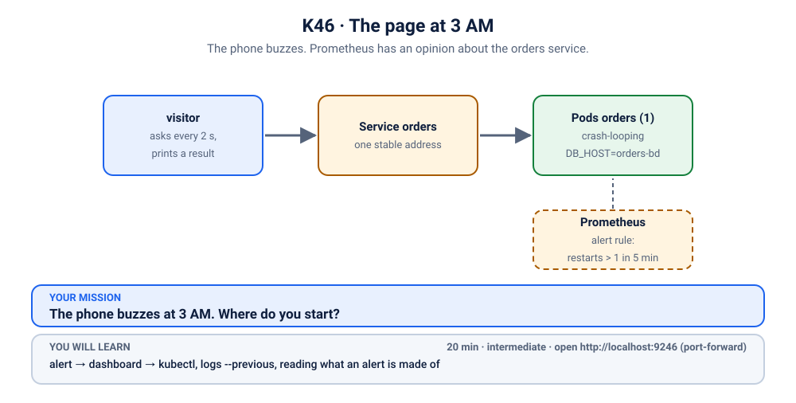
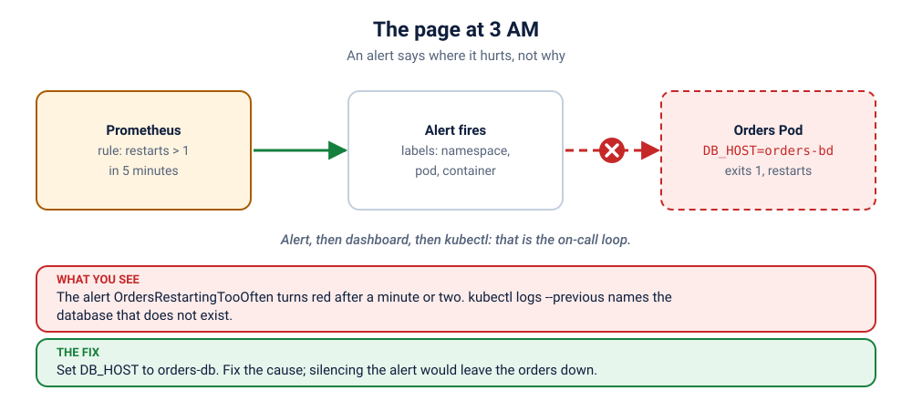

# K46 · The page at 3 AM

*The phone buzzes. Prometheus has an opinion about the orders service.*

⏱ 20 min · intermediate · Orders service (`busybox`, 4 MB) + Prometheus and Grafana from lab K19 · alert → dashboard → `kubectl`, `logs --previous`, reading what an alert is made of

⬇️ Nothing big to download (busybox is 4 MB). The monitoring stack is a separate, one-time install.

Output columns and wording can differ a little between kubectl versions and clusters (kind, minikube, Docker Desktop, playgrounds). The ideas never change.

> 🧭 **Practice lane: "Real world: on call"**, after [K19](../../19-observability/README.md) and [K03](../03-showdown-crashloop/README.md). Guided: questions and a hint ladder. Next: [K47](../47-the-deploy-nobody-could-place/README.md).
>
> 🧰 **Needs the monitoring stack from [lab K19](../../19-observability/README.md).** Install it once (about 5 minutes, about 2 GB of memory): `./scripts/install-monitoring.sh`. The break script checks for it and tells you if it is missing.

## 📖 The story
It is the night before the college fest. The `orders` service takes biryani orders from the whole campus, and it has just been redeployed by a tired developer who also ordered biryani. At 3 AM, nobody is looking at a terminal. But **Prometheus is**, and it has a rule: *if the orders service restarts more than once in five minutes, wake someone up*. The phone buzzes.

Your job is the real one: start from the alert, not from a guess.

## 🏆 Rules of this one
- **Start from the alert, not from `kubectl get pods`.** That is what on-call means.
- **Hint ladder:** open one tier at a time.
- **Say your prediction first.**



## 🧠 The concept



An **alert** is a saved question with a condition: "restarts in the last 5 minutes > 1". Prometheus asks it every 30 seconds or so. When the answer is yes the alert is **firing**, and its **labels** (namespace, pod, container) tell you where to look next. That is the on-call loop:

1. **Alert**: what is wrong, and where? (labels)
2. **Dashboard**: since when, how bad? (graph)
3. **`kubectl`**: why? (`describe`, `logs --previous`)

The alert rule here is a `PrometheusRule`, a Kubernetes object the monitoring stack reads. It lives in the scenario's namespace, next to the app.

## 🔮 Predict first
The orders Pod crashes and restarts. Your visitor shows ❌ most of the time. Which will notice the problem first, the alert or the visitor? Write it down.

<details><summary>Check your prediction</summary>

The visitor, within seconds. The alert needs two restarts inside its window, plus a scrape and a rule evaluation, so it fires after about one to two minutes. Alerts are not instant. That delay is why a good rule looks at a window, not a single event.
</details>

## 💥 Break it
```bash
cd break && ./break.sh
```
```bash
kubectl port-forward -n monitoring svc/kube-prometheus-stack-prometheus 9090:9090
```
Open http://localhost:9090/alerts. (Grafana: `kubectl port-forward -n monitoring svc/kube-prometheus-stack-grafana 3000:80`, login `admin` / `z2h-grafana`.)
```bash
kubectl logs -f visitor -n k-46-3am
```
Stop the logs with Ctrl+C. Wait for **OrdersRestartingTooOften** to turn red on the alerts page.

## 🔍 Investigate: you drive
**What is the first thing you look at?**
<details><summary>💡 Tier 1: a nudge</summary>
Read the alert first: its labels say which namespace and Pod. Then ask `kubectl` about that Pod only.
</details>
<details><summary>💡 Tier 2: the commands</summary>

```bash
kubectl get pods -n k-46-3am
kubectl describe pod -n k-46-3am -l app=orders | tail -n 15
kubectl logs -n k-46-3am -l app=orders --previous
```
`--previous` shows the run that just died: the current one has barely started.
</details>
<details><summary>💡 Tier 3: the answers to look for</summary>

The log says `no database called orders-bd, giving up`. The Deployment sets `DB_HOST=orders-bd`, one letter off from the database `orders-db`. The container exits 1, the kubelet restarts it, and the restart counter is what the alert watches.
</details>

## 🪤 The tempting wrong fix
Raise the alert threshold, or silence it, "so it stops buzzing". The page goes quiet and the orders are still down. **An alert is a messenger, not the problem.**

## 🩺 Root cause
<details><summary>Reveal after the room guesses</summary>

The Deployment points the orders service at a database name with two letters swapped. The service refuses to start without its database and exits, so it crash-loops. The restart counter, which kube-state-metrics exports, crosses the rule's threshold and the alert fires.
</details>

## 🔧 Fix it
```bash
cd ../fix && ./fix.sh
```
The reference fix sets `DB_HOST` to `orders-db`. By hand: `kubectl edit deployment orders -n k-46-3am`.

## ✅ Verify it yourself
```bash
cd .. && ./check.sh
```
It checks that the Deployment is Ready and the visitor shows ✅. The alert clears by itself a few minutes after the restarts stop, because its window looks five minutes back.

## 🎯 Key takeaways
- **Start from the alert, then the dashboard, then `kubectl`.**
- **Alert labels tell you where to look.** Use them.
- **`logs --previous`** is the log of the run that died.
- **Fix the cause, not the alarm.**

## 💎 Lifelong lesson
> An alert tells you where it hurts. It does not tell you why.

## 🏢 Where you'll meet this at work
- **A config typo in a late-night deploy** (everyone).
- **On-call rotations**, where the first five minutes decide the night (platform team).

## 🧹 Clean up
```bash
./cleanup.sh
```

## Next →
Next in the lane: [K47](../47-the-deploy-nobody-could-place/README.md).
