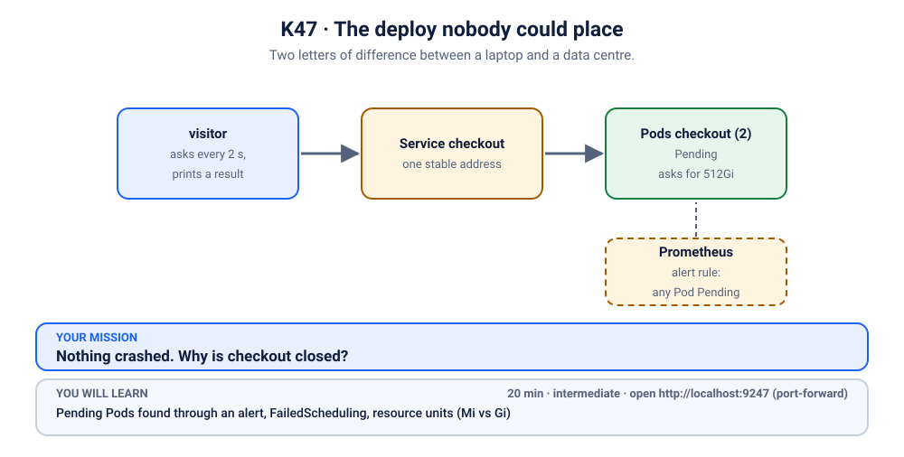
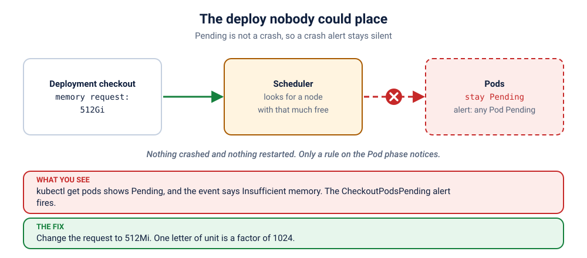

# K47 · The deploy nobody could place

*Two letters of difference between a laptop and a data centre.*

⏱ 20 min · intermediate · Checkout service (`http-echo`, 17 MB) + Prometheus from lab K19 · Pending Pods found through an alert, `FailedScheduling`, resource units (`Mi` vs `Gi`)

⬇️ Nothing big: the 17 MB `hashicorp/http-echo` image. The monitoring stack is a separate, one-time install.

Output columns and wording can differ a little between kubectl versions and clusters (kind, minikube, Docker Desktop, playgrounds). The ideas never change.

> 🧭 **Practice lane: "Real world: on call"**, after [K46](../46-the-3-am-page/README.md) and [K09](../../09-resources-qos/README.md). Mostly solo: questions only. Next: [K48](../48-the-slow-memory-ramp/README.md).
>
> 🧰 **Needs the monitoring stack from [lab K19](../../19-observability/README.md).** Install it once (about 5 minutes, about 2 GB of memory): `./scripts/install-monitoring.sh`. The break script checks for it and tells you if it is missing.

## 📖 The story
Black Friday is two days away, and the checkout service is getting a facelift. A developer moves the memory request into a shared config and types `512Gi` where the old file said `512Mi`. Review sees "just a number". The pipeline is green. The Pods are not: Kubernetes looks for a node with half a terabyte free, finds none, and waits. Checkout is closed, and **nothing crashed**, so no crash alert fires. Only the Pending alert notices.

## 🏆 Rules of this one
- **Questions only.** Predict, investigate, fix.
- **There is nothing to read in the logs.** The Pods never started.
- **Use the alert** to get a head start.



## 🧠 The concept



A Pod that cannot be placed stays **Pending**. Nothing crashes, nothing restarts, so a crash-loop alert is silent. You need a rule that watches the *phase*: `kube_pod_status_phase{phase="Pending"} > 0`. The cause is always in the Pod's **Events**, from the scheduler: `FailedScheduling`, with the reason (`Insufficient memory`, an untolerated taint, an unmatched selector).

Units matter: `Mi` is mebibytes, `Gi` is gibibytes, and a Pod's memory is a number with a unit. One letter is a factor of 1024.

## 🔮 Predict first
The Pods ask for a huge amount of memory. Will they crash, restart, or sit somewhere? What will `kubectl get pods` show? Write it down.

<details><summary>Check your prediction</summary>

They sit in `Pending`, with 0 restarts. A Pod that never starts cannot crash. The scheduler cannot find a node that fits the request and keeps trying.
</details>

## 💥 Break it
```bash
cd break && ./break.sh
```
```bash
kubectl port-forward -n monitoring svc/kube-prometheus-stack-prometheus 9090:9090
```
Open http://localhost:9090/alerts. (Grafana: `kubectl port-forward -n monitoring svc/kube-prometheus-stack-grafana 3000:80`, login `admin` / `z2h-grafana`.)
```bash
kubectl get pods -n k-47-capacity
kubectl logs -f visitor -n k-47-capacity
```
Stop the logs with Ctrl+C. The alert is **CheckoutPodsPending**.

## 🔍 Investigate: you drive
**What is the first thing you look at?**
<details><summary>💡 Tier 1: a nudge</summary>
The alert says Pods are Pending. Pending means the scheduler said no. Ask the Pod for the scheduler's reason.
</details>
<details><summary>💡 Tier 2: the commands</summary>

```bash
kubectl describe pod -n k-47-capacity -l app=checkout | grep -A6 Events
kubectl get deployment checkout -n k-47-capacity -o jsonpath='{.spec.template.spec.containers[0].resources}{"\n"}'
kubectl describe nodes | grep -A6 "Allocatable"
```
</details>
<details><summary>💡 Tier 3: the answers to look for</summary>

The event says `Insufficient memory`. The request is `512Gi`, and each node has a few Gi at most. The intended value was `512Mi`.
</details>

## 🪤 The tempting wrong fix
Add nodes, or turn on a cluster autoscaler, "because there is not enough capacity". There is plenty: the request is absurd, not the cluster. **Check the number before you buy more machines.**

## 🩺 Root cause
<details><summary>Reveal after the room guesses</summary>

The Deployment requests `512Gi` of memory per Pod, more than any node has, so the scheduler can place neither Pod. They stay Pending, nothing crashes, and only the phase-based alert notices.
</details>

## 🔧 Fix it
```bash
cd ../fix && ./fix.sh
```
The reference fix changes the request to `512Mi`. By hand: `kubectl edit deployment checkout -n k-47-capacity`.

## ✅ Verify it yourself
```bash
cd .. && ./check.sh
```
It checks that both Pods are placed and Ready, and the visitor shows ✅.

## 🎯 Key takeaways
- **Pending is not a crash.** Different symptom, different alert, different place to look.
- **Scheduler events carry the reason.** Read them.
- **Units are a factor of 1024.** Review them like code.

## 💎 Lifelong lesson
> Pending means somebody asked for something that does not exist.

## 🏢 Where you'll meet this at work
- **A refactor that moves resource numbers** into a shared file (platform team).
- **A cloud bill** that spikes after someone "fixes" it by adding nodes (everyone).

## 🧹 Clean up
```bash
./cleanup.sh
```

## Next →
Next in the lane: [K48](../48-the-slow-memory-ramp/README.md), the boss.
