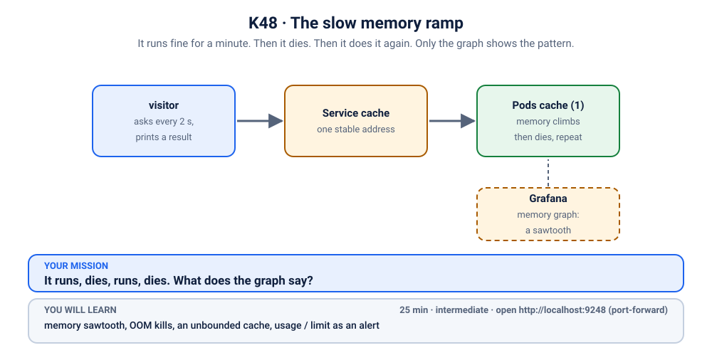
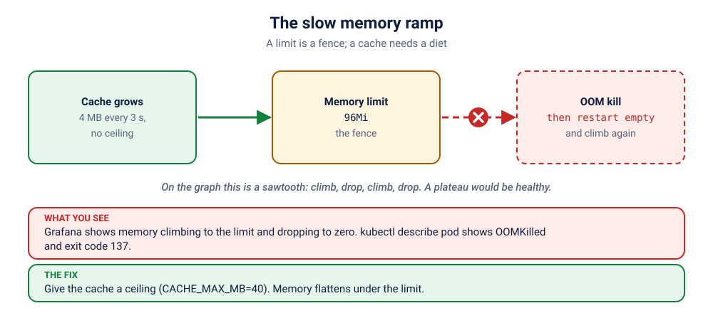

# K48 · The slow memory ramp

*It runs fine for a minute. Then it dies. Then it does it again. Only the graph shows the pattern.*

⏱ 25 min · intermediate · A cache service (`python:3.12-alpine`, about 19 MB) + Prometheus and Grafana from lab K19 · memory sawtooth, OOM kills, an unbounded cache, `usage / limit` as an alert

⬇️ A 19 MB Python image (probably already on your machine from other scenarios). The monitoring stack is a separate, one-time install.

Output columns and wording can differ a little between kubectl versions and clusters (kind, minikube, Docker Desktop, playgrounds). The ideas never change.

> 🧭 **Practice lane: "Real world: on call"**, the boss, after [K47](../47-the-deploy-nobody-could-place/README.md) and [K08](../08-ai-trainer-oomkilled/README.md). No hints for the first 5 minutes.
>
> 🧰 **Needs the monitoring stack from [lab K19](../../19-observability/README.md).** Install it once (about 5 minutes, about 2 GB of memory): `./scripts/install-monitoring.sh`. The break script checks for it and tells you if it is missing.

## 📖 The story
The `cache` service keeps recent lookups in memory so the app feels fast. Nobody put a ceiling on it, because on the developer's laptop it never filled up. In production, with real traffic, it grows a little every few seconds until the kernel steps in. The service dies, restarts empty, and starts growing again. A user sees one slow page now and then. Nobody sees a pattern, until someone looks at the memory graph and finds a **sawtooth**.

## 🏆 Rules of this one
- **First 5 minutes: no hints.** You have met OOM kills in K08 and alerts in K46.
- **Look at the graph first.** One picture explains it.
- **Scoring (for fun):** gold = under 10 minutes, no hints; silver = under 20; bronze = hints used.



## 🧠 The concept



A memory **limit** is a fence ([K08](../08-ai-trainer-oomkilled/README.md)). A **cache with no ceiling** is a balloon that keeps inflating until it hits the fence. Two pictures to know:

- **Sawtooth**: memory climbs, drops to nothing, climbs again. A restart every time. Usually a leak or an unbounded cache.
- **Plateau**: memory climbs, then stays flat. Healthy: the app found its size.

The early-warning query is `usage / limit`: when a container is above 80% of its limit it is about to be killed. Alert on that, and you hear about it *before* the kill.

## 🔮 Predict first
The cache runs for about a minute, dies, and restarts. What shape will its memory graph have, and what will `kubectl get pods` say about `RESTARTS`? Write it down.

<details><summary>Check your prediction</summary>

A sawtooth: climbs for about a minute, then drops to zero at each kill. `RESTARTS` goes up by one each cycle, and `kubectl describe pod` shows `OOMKilled`, exit code 137.
</details>

## 💥 Break it
```bash
cd break && ./break.sh
```
Watch it three ways, side by side:
```bash
kubectl get pods -n k-48-ramp -w
```
```bash
kubectl port-forward -n monitoring svc/kube-prometheus-stack-grafana 3000:80
```
In Grafana (`admin` / `z2h-grafana`) open **Kubernetes / Compute Resources / Pod**, namespace `k-48-ramp`, pod `cache-…`. Stop the first one with Ctrl+C.

## 🔍 Investigate: you drive
**What is the first thing you look at?**
<details><summary>💡 Tier 1: a nudge</summary>
Look at the memory graph, then at how the Pod last ended. Together they tell the story.
</details>
<details><summary>💡 Tier 2: the commands</summary>

```bash
kubectl describe pod -n k-48-ramp -l app=cache | grep -A4 "Last State"
kubectl logs -n k-48-ramp -l app=cache --previous | tail -n 3
kubectl get deployment cache -n k-48-ramp -o jsonpath='{.spec.template.spec.containers[0].env}{"\n"}'
```
In Prometheus: `kube_pod_container_status_last_terminated_reason{namespace="k-48-ramp"}`.
</details>
<details><summary>💡 Tier 3: the answers to look for</summary>

Last State is `OOMKilled`, exit code 137. The log ends with `cache holds N MB`, growing each time. The environment variable `CACHE_MAX_MB` is `0`, and the app's comment says 0 means "no limit".
</details>

## 🪤 The tempting wrong fix
Raise the memory limit. The sawtooth just gets taller and the kill comes later. **A limit is a fence, not a diet.** The balloon is still inflating. If the limit is the only thing that stops it, the kill is merely postponed.

## 🩺 Root cause
<details><summary>Reveal after the room guesses</summary>

The cache has no ceiling (`CACHE_MAX_MB=0`), so it grows forever. The container limit (96 Mi) is the only thing that stops it, and the kernel does so by killing the process. Restart empties it, and the ramp begins again.
</details>

## 🔧 Fix it
```bash
cd ../fix && ./fix.sh
```
The reference fix sets `CACHE_MAX_MB` to `40`: the cache stops growing at 40 MB, and memory flattens well under the limit (a plateau).

## ✅ Verify it yourself
```bash
cd .. && ./check.sh
```
It checks that the cache is Ready, its ceiling is set and sensible, and the newest Pod has not been OOM-killed. Then watch the graph flatten.

## 🎯 Key takeaways
- **A sawtooth means leak or unbounded growth.** A plateau means healthy.
- **Bound your caches.** The container limit is the last defence, not the plan.
- **Alert on `usage / limit`** to hear about it before the kill.

## 💎 Lifelong lesson
> A limit is a fence. A cache needs a diet.

## 🏢 Where you'll meet this at work
- **In-memory caches and queues** that nobody capped (developer).
- **A weekly "mystery restart"** found only when someone plots the memory (platform team).

## 🧹 Clean up
```bash
./cleanup.sh
```

## Next →
That finishes the "Real world: on call" lane. Back to the [scenario list](../README.md).
