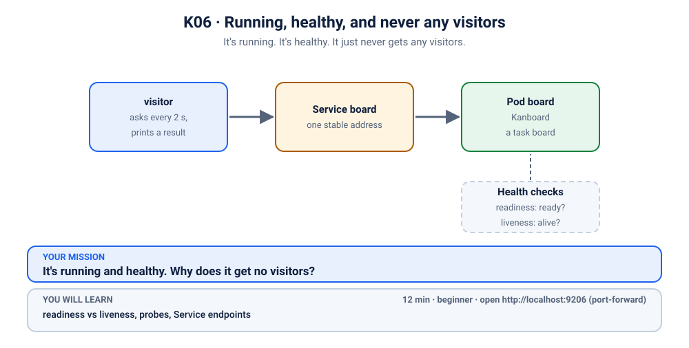
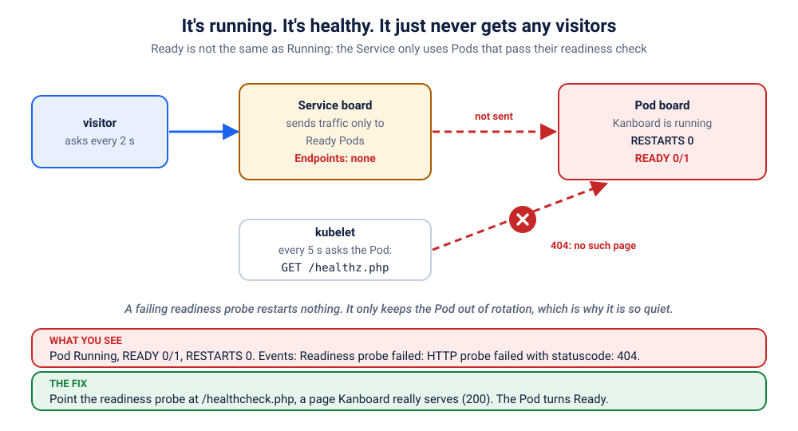

# S5.1 · Running, healthy, and never any visitors

*It's running. It's healthy. It just never gets any visitors.*

⏱ 12 min · beginner · Kanboard (`kanboard/kanboard`, about 33 MB) · readiness vs liveness, probes, Service endpoints

⬇️ First run downloads about 33 MB (Kanboard) plus a tiny 4 MB visitor image. A slow first download is normal: do it on good Wi-Fi, before the session.

Output columns and wording can differ a little between kubectl versions and clusters (kind, minikube, Docker Desktop, playgrounds). The ideas never change.

## 📖 The story
Priya's team runs a Kanboard (a Trello-style task board) for the hackathon. Before the big demo, someone adds a readiness probe "for safety", copying a path from another project. The deploy goes through. `kubectl get pods` says `Running`. There are no restarts, no crashes, no red anywhere. But the board never opens for anyone, and the Pod sits at `0/1`.



## 🧠 The concept: why, what, how
Kubernetes asks your container two different questions, and the answers do very different things:

- **Liveness probe: "Are you alive?"** If the answer is no, Kubernetes **restarts** the container.
- **Readiness probe: "Are you ready for visitors?"** If the answer is no, Kubernetes **keeps the Pod out of the Service**. Nothing is restarted. The Pod just waits, and gets no traffic.
- A probe is a small request the kubelet (the agent on each node) sends to your app, for example `GET /healthcheck.php`. A status below 400 (200, or even a 302 redirect) passes. A 404 or 500 fails.
- Think of a restaurant: liveness is "is the chef breathing?" and readiness is "is the kitchen open for orders?". A closed kitchen doesn't fire the chef; the waiter just stops seating guests there.

```
 visitor ──▶ Service "board" ──▶ only READY Pods ──▶ Pod
                                 Pod fails readiness (404)  → removed from the list → nobody gets served
```

## 🏢 Where you'll meet this at work
- **A wrong path after an upgrade.** The new version moved `/health` to `/healthz`, the Deployment still checks the old one (developer, platform team).
- **A dependency check inside readiness.** The probe also checks the database. The database blips, every Pod goes unready at once, and the whole service disappears (SRE, on-call).
- **A copy-pasted probe** from a different app. It looks right and nobody ever tests it.

## 💥 Break it
```bash
cd break && python3 run.py
```
What the room should see: the script finishes happily. The Kanboard Pod is `Running`, nothing has crashed, and the Service exists. But a small `visitor` Pod, which asks for the board every 2 seconds, never gets an answer:
```bash
kubectl logs -f visitor -n k-06-never-ready
```
```
❌ 01:28:18 no answer from http://board
❌ 01:28:21 no answer from http://board
```
You can stop it with Ctrl+C. We'll watch it again live when we fix things.

## 🔮 Predict first (60 seconds)
Kanboard is installed, but nobody can reach it. Before you run anything:
1. Will the `RESTARTS` column go up?
2. Which kind of probe do you suspect, readiness or liveness, and why?

<details><summary>Check your prediction</summary>

1. No. Nothing is crashing, so nothing restarts.
2. Readiness. A readiness probe only decides whether a Pod may receive traffic, so the symptom is "running but nobody gets in". A failing *liveness* probe would show up as restarts instead.
</details>

## 🔍 Investigate
Guess first, then run these **in order**. The visitor's log already told us the symptom: nobody is served.

**1. Is the Pod OK?** Always start with the Pods.
```bash
kubectl get pods -n k-06-never-ready
```
```
NAME                     READY   STATUS    RESTARTS   AGE
board-6b7f4dbdcb-6gknm   0/1     Running   0          10s
visitor                  1/1     Running   0          10s
```
(Ages and Pod names will differ.) Look at the `board` line: `STATUS` is `Running`, `RESTARTS` is `0`, but `READY` is **0/1**. The container is up, yet Kubernetes does not consider it ready.

<details><summary>💡 Hint</summary>
RESTARTS is 0, so nothing is being killed: that rules out the crash-and-restart story from <a href="../03-showdown-crashloop/README.md">S1.3</a>. Something decides the Pod is "not ready". What does it ask the app, and what does the app answer?
</details>

**2. What does Kubernetes say about it?** `describe` shows the readiness check and the events.
```bash
kubectl describe pod -n k-06-never-ready -l app=board
```
```
    Ready:          False
    Restart Count:  0
    Readiness:      http-get http://:80/healthz.php delay=0s timeout=1s period=5s #success=1 #failure=3
...
Events:
  Type     Reason     Age   From     Message
  ----     ------     ----  ----     -------
  Normal   Started    2s    kubelet  Started container board
  Warning  Unhealthy  0s    kubelet  Readiness probe failed: HTTP probe failed with statuscode: 404
```
(shortened: the full output is long; look for the `Readiness:` line and the Warning at the bottom. Exact event columns vary by kubectl version.) The kubelet asks `GET /healthz.php` on port 80 and gets **404**, again and again.

**3. What does that do to the Service?** Check who the Service is allowed to send visitors to.
```bash
kubectl get endpointslices -n k-06-never-ready -l kubernetes.io/service-name=board -o jsonpath='{..conditions}'; echo
```
```
{"ready":false,"serving":false,"terminating":false}
```
The Pod's address is listed, but marked `"ready":false`, so the Service sends it no traffic. The older (deprecated) view shows the same thing as an empty list:
```bash
kubectl get endpoints board -n k-06-never-ready
```
```
Warning: v1 Endpoints is deprecated in v1.33+; use discovery.k8s.io/v1 EndpointSlice
NAME    ENDPOINTS   AGE
board               3s
```
(The warning line only appears on newer kubectl versions.) `ENDPOINTS` is empty: nobody is behind the Service.

**4. Is the app really broken, or only the check?** Ask Kanboard the same question the kubelet asks, from inside the Pod. Use `127.0.0.1` here (not `localhost`): Kanboard listens on IPv4 only, and `localhost` may try IPv6 first.
```bash
POD=$(kubectl get pod -n k-06-never-ready -l app=board -o jsonpath='{.items[0].metadata.name}')
kubectl exec -n k-06-never-ready $POD -- wget -S -O /dev/null http://127.0.0.1/healthz.php
```
```
Connecting to 127.0.0.1 (127.0.0.1:80)
  HTTP/1.1 404 Not Found
wget: server returned error: HTTP/1.1 404 Not Found
command terminated with exit code 1
```
(The exact wording of the last line varies by kubectl version.) The path the probe checks does not exist. Does the app itself work? Kanboard ships a real health page, `healthcheck.php`:
```bash
kubectl exec -n k-06-never-ready $POD -- wget -qO- http://127.0.0.1/healthcheck.php; echo
```
```
{"status":200,"message":"Database connection is OK"}
```
The app is perfectly healthy. Only the probe's path is wrong.

## 🪤 The tempting wrong fix: more Pods
"One Pod is not enough. Let's add more."
```bash
kubectl scale deployment board -n k-06-never-ready --replicas=5
kubectl get pods -n k-06-never-ready
```
Five Pods, all `0/1`. Every new Pod asks for the same page that does not exist, so you have five times the nothing. Scaling multiplies a problem as happily as it multiplies a solution. (Put it back with `--replicas=1` when you are done laughing.)

## 🩺 Root cause
<details><summary>Reveal after the room guesses</summary>

The Deployment's readiness probe asks for `/healthz.php`, which Kanboard doesn't have, so every check returns **404** and the Pod is never marked Ready. A Pod that isn't Ready is left out of the Service's endpoints, so no visitor is ever served. A failing *readiness* probe never restarts anything (`RESTARTS` stays 0), which is why this failure is so quiet. Nothing is wrong with Kanboard, the image or the cluster.


</details>

## 🔧 Fix it
Before you run it, open a **second terminal** and start the live visitor log, so the room sees red turn green:
```bash
kubectl logs -f visitor -n k-06-never-ready
```
Then, in the first terminal:
```bash
cd ../fix && python3 run.py
```
Within about ten seconds the log flips from ❌ to ✅ lines (Ctrl+C to stop it):
```
❌ 01:28:24 no answer from http://board
❌ 01:28:27 no answer from http://board
✅ 01:28:30 HTTP 200
✅ 01:28:32 HTTP 200
```
(shortened.) Changing the probe changes the Pod template, so Kubernetes rolls out a fresh Pod on its own. What changed:
```bash
diff ../break/app.yaml app.yaml
```
```
24c24
<               path: /healthz.php
---
>               path: /healthcheck.php
```

By hand (this replaces `./fix.sh`, so you don't need to run both): from the `fix` folder, apply the corrected file, then wait for the new Pod.
```bash
kubectl apply -f app.yaml
kubectl rollout status deployment/board -n k-06-never-ready --timeout=180s
```
Pro tip: `/` would also pass (Kanboard answers it with a 302 redirect to the login page, and anything below 400 counts as success), but `/healthcheck.php` is better: it also confirms the database works.

## ✅ Verify it yourself
Short on time? `cd .. && ./check.sh` says in one line whether you are done. It only looks, it never changes anything. The steps below show you *why* it says so.

```bash
kubectl get pods -n k-06-never-ready
```
```
NAME                     READY   STATUS    RESTARTS   AGE
board-5df664b878-2hzs9   1/1     Running   0          21s
visitor                  1/1     Running   0          32s
```
(Names and ages will differ.) `READY` is now **1/1**, and the old Pod is gone (it may show `Terminating` for a moment). The Service has a ready address again, and the visitor's log is green (if you still see a ❌, wait a few seconds and run it again):
```bash
kubectl logs visitor -n k-06-never-ready --tail=3
```
```
✅ 01:28:32 HTTP 200
✅ 01:28:34 HTTP 200
✅ 01:28:36 HTTP 200
```
Now open it yourself. In a **second terminal** (leave it running):
```bash
kubectl port-forward -n k-06-never-ready svc/board 9206:80
```
```
Forwarding from 127.0.0.1:9206 -> 80
Forwarding from [::1]:9206 -> 80
```
On a playground, add `--address 0.0.0.0` and open the URL for port 9206.
Back in the first terminal:
```bash
curl -s localhost:9206/healthcheck.php; echo
```
```
{"status":200,"message":"Database connection is OK"}
```
(The port-forward terminal also prints `Handling connection for 9206`.) Or open http://localhost:9206 in your browser. Kanboard's login is `admin` / `admin`: change it on any real board. Press Ctrl+C in the second terminal to stop the port-forward.

## 👀 See it in monitoring (optional)
If you installed the monitoring stack ([lab K19](../../../19-observability/README.md)), watch Running but not Ready as a number. In Prometheus (`kubectl port-forward -n monitoring svc/kube-prometheus-stack-prometheus 9090:9090`, then http://localhost:9090) run:
```
kube_pod_status_ready{namespace="k-06-never-ready",condition="true"}
```
It stays 0 while the Pod is `Running`. That gap, running but not ready, is exactly what the Service ignores. Restarts stay flat, which is how you tell it from S1.3.

## 🎯 Key takeaways
- **Readiness gates traffic; liveness restarts.** A failing readiness probe keeps the Pod out of the Service and never restarts it.
- **`Running` is not `Ready`.** Read the `READY` column, not just `STATUS`.
- **It fails quietly.** `RESTARTS 0`, no crash: you only see it in `describe` events and the empty endpoints.
- Debug path: `get pods` (0/1) → `describe` (probe failed: 404) → endpoints (not ready) → ask the app the same question with `wget`.

## 💎 Lifelong lesson
> A probe is a promise. Test the URL it checks.

## 🧹 Clean up
Press Ctrl+C in the port-forward terminal first, then:
```bash
cd .. && ./cleanup.sh
```

## 🧪 Quick recap (3 questions)
1. A Pod is `Running`, `0/1`, and `RESTARTS` is 0. Which probe is failing?
2. In the events, how do "connection refused" and "404" differ for a failing probe?
3. Why does a failing readiness probe not restart the Pod?

<details><summary>Answers</summary>

1. Readiness. Liveness failures show up as restarts.
2. "Connection refused": nothing listens on that port. "404": something answers, but that page does not exist.
3. Its only job is to decide whether to send traffic. Restarting is the liveness probe's job.
</details>

## Next →
Next, in this section: [S5.2](../2-showdown-slow-start/README.md): A perfectly healthy app keeps getting killed, again and again, every few seconds.

🏋️ **More reps on this idea (optional):** the practice lane S5.x1 to S5.x3 ("Ready or alive?"), starting at [S5.x1](../exercises/1-doorbell-on-the-wrong-door/README.md).

