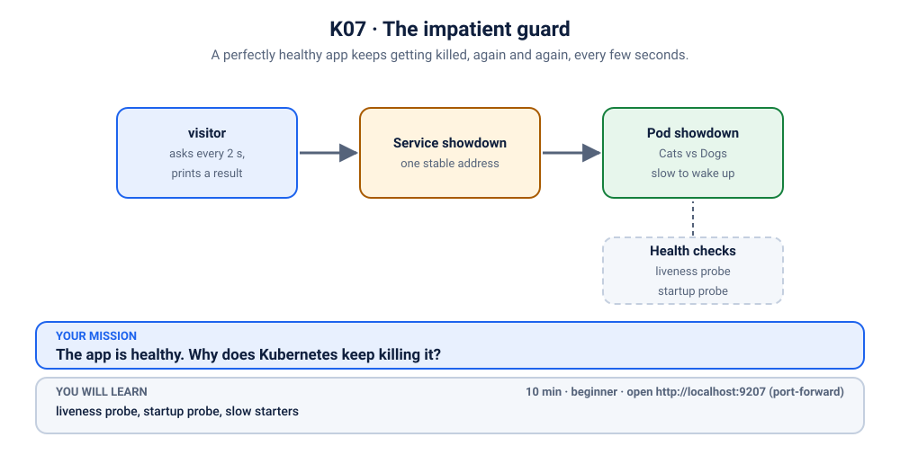
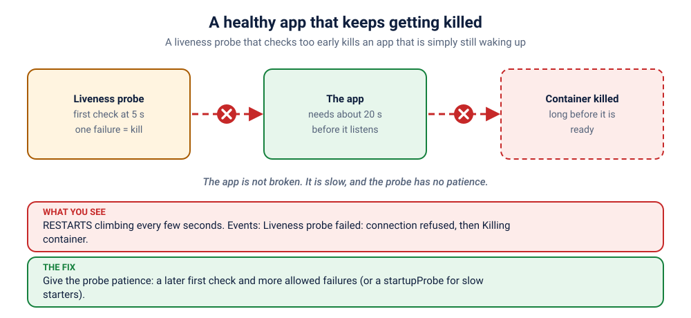

# S5.2 · The impatient guard

*A perfectly healthy app keeps getting killed, again and again, every few seconds.*

⏱ 10 min · beginner · Cats vs Dogs voting app (`python:3.12-alpine`, about 19 MB) · liveness probe, startup probe, slow starters

⬇️ First run downloads about 19 MB (Python) plus a tiny 4 MB visitor image. A slow first download is normal: do it on good Wi-Fi, before the session.

Output columns and wording can differ a little between kubectl, container runtimes and clusters (kind, minikube, Docker Desktop, playgrounds). The ideas never change.

## 📖 The story
It's the night before the Christ University fest and Ravi deploys the "Cats vs Dogs" poll. The app warms up for about 20 seconds when it starts (it "loads its data"). Priya, being careful, adds a **liveness probe** so Kubernetes will restart the app if it ever hangs. Nice idea. But now the poll never opens: the Pod restarts again and again, and nothing in the logs says "error". The app isn't broken. It is being killed for being slow to wake up.



## 🧠 The concept: why, what, how



Kubernetes has three kinds of health check ("probes"), and each asks a different question:

- **Startup probe:** "Has the app *finished starting*?" Until it passes, the other probes wait.
- **Readiness probe:** "Can it take visitors *right now*?" If not, the Pod is kept out of the Service (see [S5.1](../1-kanboard-never-ready/README.md)).
- **Liveness probe:** "Is it *still alive*?" If it fails, the kubelet **kills the container and restarts it**.

Think of a guard at a hotel desk. The liveness probe is a guard who knocks on your door and, if you don't answer, breaks it down. Fine for a guest who has fainted, terrible for a guest who is still putting on shoes. A **startup probe** tells the guard: "give this guest a full minute to get dressed before you start knocking."

```
 start ──▶ [ app is warming up: 20 s ] ──▶ listening
              ▲
   liveness knocks at 5 s ... no answer ... KILL ──▶ start again ──▶ knocks at 5 s ... KILL ...
```

## 🏢 Where you'll meet this at work
- **Java / Spring Boot services** that need 30 to 90 seconds to warm up, especially when the node is busy (developer, SRE).
- **Apps that load a big model or cache at boot**, such as an AI service reading a model file into memory (ML engineer, platform team).
- **Database migrations at start-up:** the app runs schema changes before it listens (developer, SRE).

## 💥 Break it
```bash
cd break && ./break.sh
```
What the room should see: the script says the app was deployed, but it never becomes ready. The Pod says `Running` but `0/1`, its `RESTARTS` count keeps climbing, and nobody can vote. A small `visitor` Pod keeps asking the app for `/healthz` every 2 seconds and gets no answer:
```bash
kubectl logs -f visitor -n k-07-slow-start
```
```
❌ 04:09:04 no answer from http://showdown/healthz
❌ 04:09:07 no answer from http://showdown/healthz
❌ 04:09:10 no answer from http://showdown/healthz
```
You can stop it with Ctrl+C. We'll watch it again live when we fix things.

## 🔮 Predict first: do the maths
The app needs about 20 seconds to wake up. The liveness probe starts checking after `initialDelaySeconds: 5`, and gives up after `failureThreshold: 1` miss.
1. Roughly when will the first restart happen?
2. Will the app ever become ready?

<details><summary>Check your prediction</summary>

1. At about 5 seconds: the first check fails, one miss is all it takes, and the container is replaced. The watch below shows exactly that, a restart about every 5 seconds.
2. Never. The app needs 20 s and is killed at 5 s, every time.
</details>

## 🔍 Investigate
Guess first, then run these **in order**.

**1. What is the Pod doing?** Watch it for a minute: this is the symptom.
```bash
kubectl get pods -n k-07-slow-start -w
```
```
NAME                       READY   STATUS              RESTARTS     AGE
showdown-976689b99-z7b86   0/1     ContainerCreating   0            0s
showdown-976689b99-z7b86   0/1     Running             0            1s
showdown-976689b99-z7b86   0/1     Running             1 (1s ago)   6s
showdown-976689b99-z7b86   0/1     Running             2 (1s ago)   11s
showdown-976689b99-z7b86   0/1     CrashLoopBackOff    2 (1s ago)   16s
showdown-976689b99-z7b86   0/1     Running             3 (16s ago)  31s
showdown-976689b99-z7b86   0/1     Running             4 (1s ago)   41s
showdown-976689b99-z7b86   0/1     CrashLoopBackOff    4 (1s ago)   46s
showdown-976689b99-z7b86   0/1     Running             5 (50s ago)  95s
```
(Shortened: it keeps going. Ages, Pod names and exact timings will differ, and `-w` prints a new line on every change. Press Ctrl+C when you've seen enough.) The Pod is `Running` but never `1/1`, and `RESTARTS` climbs: the first restart comes after only about 6 seconds, the next about 5 seconds later. The kubelet **backs off** between restarts, so the waits between restarts grow (a few seconds at first, then longer and longer, up to 5 minutes) and `CrashLoopBackOff` appears in between, as in [S1.3](../../1-architecture-and-pod-lifecycle/3-showdown-crashloop/README.md). Nobody typed `kubectl delete`: something is killing it.

<details><summary>💡 Hint</summary>
Is the app crashing, or is somebody killing it? Which part of Kubernetes is allowed to kill a container, and what rule does it use? Compare the app's start-up time with how long Kubernetes waits before it first checks.
</details>

**2. Who killed it?** `describe` lists the events and the probe settings.
```bash
kubectl describe pod -n k-07-slow-start -l app=showdown | grep -E 'Liveness|Killing|Unhealthy'
```
```
    Liveness:       http-get http://:8080/healthz delay=5s timeout=1s period=5s #success=1 #failure=1
  Warning  Unhealthy  89s (x15 over 2m43s)  kubelet            spec.containers{showdown}: Readiness probe failed: Get "http://10.244.2.82:8080/readyz": dial tcp 10.244.2.82:8080: connect: connection refused
  Warning  Unhealthy  89s (x5 over 2m34s)   kubelet            spec.containers{showdown}: Liveness probe failed: Get "http://10.244.2.82:8080/healthz": dial tcp 10.244.2.82:8080: connect: connection refused
  Normal   Killing    34s (x6 over 2m34s)   kubelet            spec.containers{showdown}: Container showdown failed liveness probe, will be restarted
```
(The IP addresses and counts will differ.) There is the culprit, in the kubelet's own words: `Liveness probe failed` followed by `Container showdown failed liveness probe, will be restarted`. The probe checks `/healthz` after `delay=5s`, then every `period=5s`, and `#failure=1` means one failed check is enough. "Connection refused" means nothing was listening yet. The `Readiness probe failed` line is the same story: during its 20-second sleep the app isn't listening, so the readiness check is refused too. It is only a symptom here; the `Killing` line is the one that matters.

**3. What was the app doing in those 5 seconds?** Read the last words of the container that was killed.
```bash
kubectl logs -n k-07-slow-start -l app=showdown --previous
```
```
2026-11-08T04:08:42 [showdown-976689b99-b2jrf] simulating slow startup: sleeping 20.0s
2026-11-08T04:08:48 [showdown-976689b99-b2jrf] received signal 15, shutting down gracefully 👋
```
No error, no traceback. The app says it is "simulating slow startup: sleeping 20.0s", and only 6 seconds later it receives signal 15 (SIGTERM, the polite "please stop" from the kubelet). It was killed in the middle of waking up, before it ever listened. (Because the app handled the signal politely, `describe` will show `Exit Code: 0` here, not a crash code. This is not a crash.)

**4. What rule did the kubelet apply?** Look at the probe in the Deployment.
```bash
kubectl get deploy showdown -n k-07-slow-start -o yaml | grep -A8 '^ *livenessProbe:'
```
```
        livenessProbe:
          failureThreshold: 1
          httpGet:
            path: /healthz
            port: 8080
            scheme: HTTP
          initialDelaySeconds: 5
          periodSeconds: 5
          successThreshold: 1
```
The kubelet starts knocking after 5 seconds, gives up after 1 failure, and the app needs 20 seconds. 5 < 20: it can never win.

## 🪤 The tempting wrong fix: delete the Pod
"Give it a fresh start."
```bash
kubectl delete pods -n k-07-slow-start -l app=showdown
kubectl get pods -n k-07-slow-start -w
```
The new Pod is exactly as slow as the old one, and the probe is exactly as impatient, so you get the same loop with a different Pod name. A fresh start does not help when the *rules* are the problem. Press Ctrl+C when you have seen enough.

## 🩺 Root cause
<details><summary>Reveal after the room guesses</summary>

The app needs about 20 seconds (`STARTUP_DELAY: "20"`) before it listens on port 8080. The liveness probe starts checking after `initialDelaySeconds: 5`, and `failureThreshold: 1` means the very first refused connection is fatal. So the kubelet kills the container at about 5 to 6 seconds, every time, long before the app is ready. The kubelet also waits longer between restarts each time (`CrashLoopBackOff`). The app is healthy; the probe is simply too impatient for a slow starter.
</details>

## 🔧 Fix it
Before you run it, open a **second terminal** and start the live visitor log, so the room sees red turn green:
```bash
kubectl logs -f visitor -n k-07-slow-start
```
Then, in the first terminal:
```bash
cd ../fix && ./fix.sh
```
The script waits for the new Pod, which takes about 25 seconds because the app really does need its 20 seconds to wake up. Then the log flips from ❌ to ✅ lines (Ctrl+C to stop it). The fix keeps the liveness probe exactly as it is and adds a **startupProbe** in front of it. What changed:
```bash
diff ../break/app.yaml app.yaml
```
```
29a30,35
>           startupProbe:
>             httpGet:
>               path: /healthz
>               port: 8080
>             periodSeconds: 5
>             failureThreshold: 12    # 12 x 5 s = up to 60 s to start
```
The startup probe checks `/healthz` every 5 seconds and tolerates 12 failures: the app has up to 60 seconds. Liveness and readiness wait until it passes, then liveness works as before and still protects against a hang later.

By hand (this replaces `./fix.sh`, so you don't need to run both): apply the fixed file from the `fix` folder.
```bash
kubectl apply -f app.yaml
```
Kubernetes starts a new Pod with the startup probe and removes the old one. Wait about 25 seconds for the new Pod to become `1/1` before you start verifying.

## ✅ Verify it yourself
Short on time? `cd .. && ./check.sh` says in one line whether you are done. It only looks, it never changes anything. The steps below show you *why* it says so.

```bash
kubectl get pods -n k-07-slow-start
```
```
NAME                        READY   STATUS    RESTARTS   AGE
showdown-7597cc744f-7qvd8   1/1     Running   0          27s
visitor                     1/1     Running   0          3m12s
```
(Ages and Pod names will differ.) One app Pod, `1/1` Ready and `0` restarts, and it stays that way. The visitor's log is green (if you still see a ❌, wait a few seconds and run it again):
```bash
kubectl logs visitor -n k-07-slow-start --tail=3
```
```
✅ 04:09:49 HTTP 200
✅ 04:09:51 HTTP 200
✅ 04:09:53 HTTP 200
```
The app's own log shows the 20-second wake-up completing, with no kill in between:
```bash
kubectl logs -n k-07-slow-start -l app=showdown
```
```
2026-11-08T04:09:24 [showdown-7597cc744f-7qvd8] simulating slow startup: sleeping 20.0s
2026-11-08T04:09:44 [showdown-7597cc744f-7qvd8] 🚀 Cats vs Dogs v1.0.0 (Cats vs Dogs) listening on :8080, votes stored in MEMORY (this container only)
```
And both probes are on the Pod:
```bash
kubectl describe pod -n k-07-slow-start -l app=showdown | grep -E 'Startup:|Liveness:'
```
```
    Liveness:       http-get http://:8080/healthz delay=5s timeout=1s period=5s #success=1 #failure=1
    Startup:        http-get http://:8080/healthz delay=0s timeout=1s period=5s #success=1 #failure=12
```
(`kubectl describe` may also list a few `Startup probe failed` events from the first 20 seconds. They are harmless: the app was still waking up, and the startup probe is allowed 12 failures.) Now open it yourself. In a **second terminal** (leave it running):
```bash
kubectl port-forward -n k-07-slow-start svc/showdown 9207:80
```
```
Forwarding from 127.0.0.1:9207 -> 8080
Forwarding from [::1]:9207 -> 8080
```
On a playground, add `--address 0.0.0.0` and open the URL for port 9207.
Back in the first terminal:
```bash
curl -s -o /dev/null -w '%{http_code}\n' localhost:9207
```
```
200
```
Or open http://localhost:9207 in your browser and cast a vote. Press Ctrl+C in the second terminal to stop the port-forward.

## 👀 See it in monitoring (optional)
If you installed the monitoring stack ([lab K19](../../../19-observability/README.md)), watch a liveness probe that kills a healthy app as a number. In Prometheus (`kubectl port-forward -n monitoring svc/kube-prometheus-stack-prometheus 9090:9090`, then http://localhost:9090) run:
```
increase(kube_pod_container_status_restarts_total{namespace="k-07-slow-start"}[5m])
```
A steady staircase of restarts, one every few seconds. Compare with S1.3: same counter, but this app was never broken. Only the graph plus the probe settings tell you which one you have.

## 🎯 Key takeaways
- **Liveness restarts; startup waits.** A liveness probe that fires before the app is up kills a healthy app over and over.
- **Give slow starters a `startupProbe`.** Budget = `periodSeconds` × `failureThreshold` (here 5 × 12 = 60 s). Liveness only begins once it passes.
- **No crash, no error.** The only clues are the `Killing … failed liveness probe` event and a log that stops mid-start-up.
- Debug path: `get pods -w` (rising restarts) → `describe` (liveness failed, killed) → `logs --previous` ("simulating slow startup") → the probe settings in the Deployment.

## 💎 Lifelong lesson
> Never let liveness judge an app that hasn't finished waking up.

## 🧹 Clean up
Press Ctrl+C in the port-forward terminal first, then:
```bash
cd .. && ./cleanup.sh
```

## 🧪 Quick recap (3 questions)
1. What does a liveness probe do when it fails, and how is that different from readiness?
2. What does a startup probe do?
3. An app needs 40 s to start. Why is a bigger `initialDelaySeconds` a weaker fix than a startup probe?

<details><summary>Answers</summary>

1. It restarts the container. A failing readiness probe only withholds traffic.
2. It holds back the other probes until the app has started, then steps aside.
3. A delay is a fixed guess that also delays detecting real crashes later. A startup probe waits only as long as needed, up to a generous limit.
</details>

## 🏋️ Now you try: the "Ready or alive?" practice lane
You have now seen both probe failures once, with every step explained ([S5.1](../1-kanboard-never-ready/README.md) and this one). Lock it in with three more problems, each with less help than the last:

| # | Practice | What is new | Hand-holding |
|---|----------|-------------|--------------|
| [S5.x1](../x1-doorbell-on-the-wrong-door/README.md) | The doorbell on the wrong door | a readiness probe with the wrong *port* | guided questions + hint ladder |
| [S5.x2](../x2-biryani-that-needs-20-seconds/README.md) | The biryani that needs 20 seconds | a slow starter, and the timing maths | questions only |
| [S5.x3](../x3-two-probes-two-mistakes/README.md) | Two probes, two mistakes | both probes wrong at once (boss) | no hints for 5 minutes |

Each one has a `./check.sh` that tells you, any time, whether you are done.

## Next →
Next, in this section: [S5.3](../3-showdown-hpa-not-scaling/README.md): Traffic is pouring in. The autoscaler shrugs: "unknown".

🏋️ **More reps on this idea (optional):** the practice lane S5.x1 to S5.x3 ("Ready or alive?"), starting at [S5.x1](../x1-doorbell-on-the-wrong-door/README.md).

