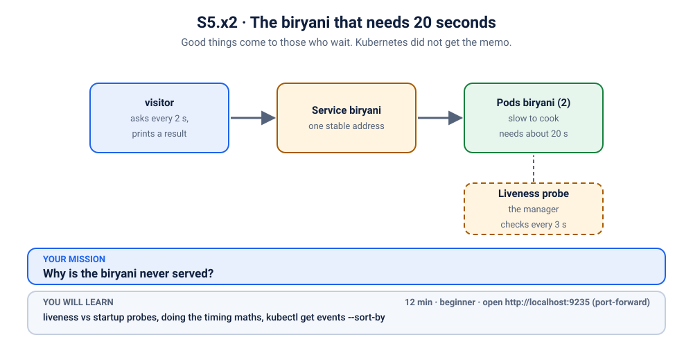
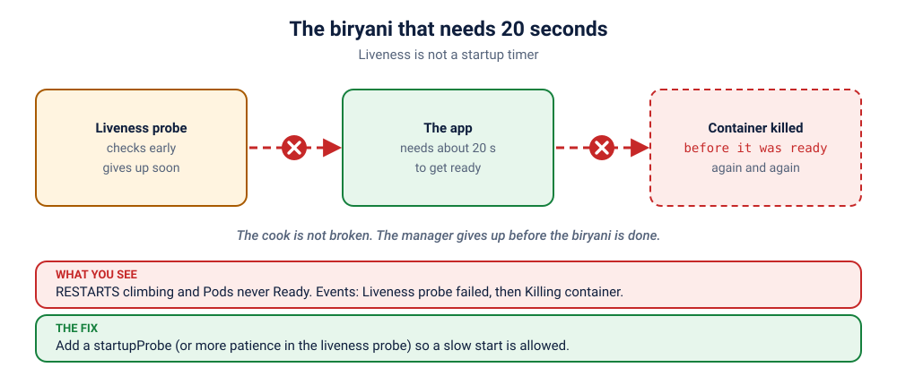

# S5.x2 · The biryani that needs 20 seconds

*Good things come to those who wait. Kubernetes did not get the memo.*

⏱ 12 min · beginner · Biryani counter (`busybox`, about 4 MB, already on your machine from the other scenarios) · liveness vs startup probes, doing the timing maths, `kubectl get events --sort-by`

⬇️ Nothing big to download: this scenario reuses the 4 MB busybox image. A slow first pull is still normal.

Output columns and wording can differ a little between kubectl versions and clusters (kind, minikube, Docker Desktop, playgrounds). The ideas never change.

> 🧭 **Practice lane: "Ready or alive?"** Problem 2 of 3, after [S5.x1](../1-doorbell-on-the-wrong-door/README.md). Same lesson as [S5.2](../../2-showdown-slow-start/README.md), a different kitchen: can you spot it, and fix it, with fewer hints?

## 📖 The story
Lakshmi's biryani counter has one rule: good biryani cannot be rushed. It takes 20 seconds from the moment the stove goes on until the first plate is ready, which, by the standards of computers, is practically a geological age.

The counter also has a very diligent manager (the **liveness probe**). He checks the kitchen 5 seconds after opening, then every 3 seconds, and if he gets two misses in a row he decides the cook has collapsed and **replaces the cook**. The new cook starts the same 20-second biryani. The manager checks at 5 seconds. You can see where this is going: a stall that has never served a single plate, and a manager who is extremely proud of how quickly he acts.



## 🧠 The concept: why, what, how



Kubernetes has three probes, and they answer three different questions:

| Probe | Question | If it fails |
|---|---|---|
| **readiness** | "May customers be sent here right now?" | Pod is left out of the Service. No restart. |
| **liveness** | "Is it stuck? Should I replace it?" | The container is **restarted**. |
| **startup** | "Is it still waking up? Don't judge it yet." | Holds back the other two until it passes. |

Liveness is for an app that **was running and got stuck**. It is the wrong tool for an app that is **still starting**. For slow starters there is the startup probe: it gives the app a generous window to come up, and the moment it passes, normal liveness takes over.


## 🔮 Predict first: do the maths
The liveness probe starts checking after `initialDelaySeconds: 5`, checks every `periodSeconds: 3`, and restarts the container after `failureThreshold: 2` misses. The biryani needs 20 seconds.
1. Roughly how many seconds after start will the manager give up?
2. Will the biryani ever be served?

<details><summary>Check your prediction</summary>

1. About **8 seconds**. The first check at 5 s fails, the second at 8 s fails, and the cook is replaced (5 + 3 × (2 − 1) = 8).
2. Never. The biryani needs 20 s, the manager gives up at about 8 s, and the replacement cook starts the clock again. It is a perfect loop.
</details>

## 💥 Break it
```bash
cd break && ./break.sh
```
In a second terminal, watch the Pods live:
```bash
kubectl get pods -n k-35-slow-biryani -w
```
Keep an eye on the `RESTARTS` column. (Ctrl+C to stop.) Meanwhile the visitor log shows the stall closed:
```bash
kubectl logs -f visitor -n k-35-slow-biryani
```

## 🔍 Investigate: you drive
**Q1. Is something restarting, and how fast?**
<details><summary>💡 Hint</summary>
Look at the <code>RESTARTS</code> column in the watch above. Is the number growing? Roughly how often?
</details>

**Q2. What does the cluster say it is doing, in order?** A new tool: sort events by time so they read like a story.
<details><summary>💡 Hint</summary>

```bash
kubectl get events -n k-35-slow-biryani --sort-by=.lastTimestamp
```
The newest events are at the bottom. You should see the liveness probe failing, followed by the container being killed so it can be restarted, again and again.
</details>

**Q3. How long does the liveness probe wait, and how long does the app need?**
<details><summary>💡 Hint</summary>

The probe is part of the Pod template:
```bash
kubectl get deployment biryani -n k-35-slow-biryani -o jsonpath='{.spec.template.spec.containers[0].livenessProbe}{"\n"}'
```
Work out when the manager gives up: `initialDelaySeconds + periodSeconds × (failureThreshold − 1)`. Compare it with the 20 seconds the biryani needs (the container's start command has a `sleep 20`).
</details>

## 🪤 The tempting fix that works, but is brittle
"Just make the manager more patient": raise `initialDelaySeconds` to 30.
```bash
kubectl patch deployment biryani -n k-35-slow-biryani --type json \
  -p '[{"op":"replace","path":"/spec/template/spec/containers/0/livenessProbe/initialDelaySeconds","value":30}]'
```
This genuinely works: now the first check is at 30 s and the cook would only be replaced around 33 s, later than the 20 s the biryani needs. So why is it second best?
- **It is a guess.** On a busy node the biryani might take 35 s, and you are back in the loop.
- **It delays real detection.** Every time the container starts, even after a genuine crash, liveness stays silent for 30 s.

A startup probe is better: it waits *only as long as needed* (it stops the moment the app is up) and has a generous ceiling.

## 🩺 Root cause
<details><summary>Reveal after the room guesses</summary>

The app needs about 20 seconds to start. The liveness probe starts at 5 s and gives up after about 11 s, so the container is killed before it ever becomes ready, over and over. Liveness was asked to do a startup probe's job.
</details>

## 🔧 Fix it
```bash
cd ../fix && ./fix.sh
```
The reference fix adds a **startup probe** (up to 60 s to come up, checked every 2 s); liveness only begins after it passes. The raise-the-delay fix from the trap above also passes `./check.sh`: you now know which one you would rather defend in a review.

## ✅ Verify it yourself
```bash
cd .. && ./check.sh
```
It checks that both Pods are Ready, **and then watches for 12 seconds** to be sure there are no new restarts. ("Ready" once is not the same as "stable".)

## 🎯 Key takeaways
- **Liveness restarts; readiness only withholds traffic; startup protects a slow beginning.**
- **Do the maths:** `initialDelaySeconds + periodSeconds × (failureThreshold − 1)` is roughly how long an app has to start before liveness gives up on it.
- **For slow starters, use a startup probe** instead of stretching liveness delays.
- **`kubectl get events --sort-by=.lastTimestamp`** reads a Pod's story in order.

## 💎 Lifelong lesson
> Do not judge a cook who is still arriving.

## 🏢 Where you'll meet this at work
- **JVM and big framework apps** that take 30 to 90 seconds to boot (developer).
- **A cold start** on a slow node or a large image (SRE).
- **"It works on my laptop, but restarts on the cluster"**, because the cluster is slower (everyone).

## 🧹 Clean up
```bash
./cleanup.sh
```

## Next →
[S5.x3](../3-two-probes-two-mistakes/README.md): the boss. Two managers, two mistakes, one closed stall.
