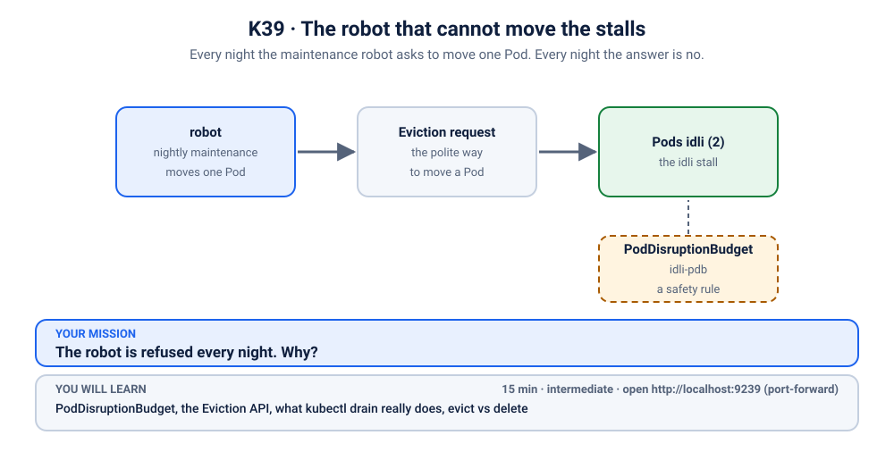
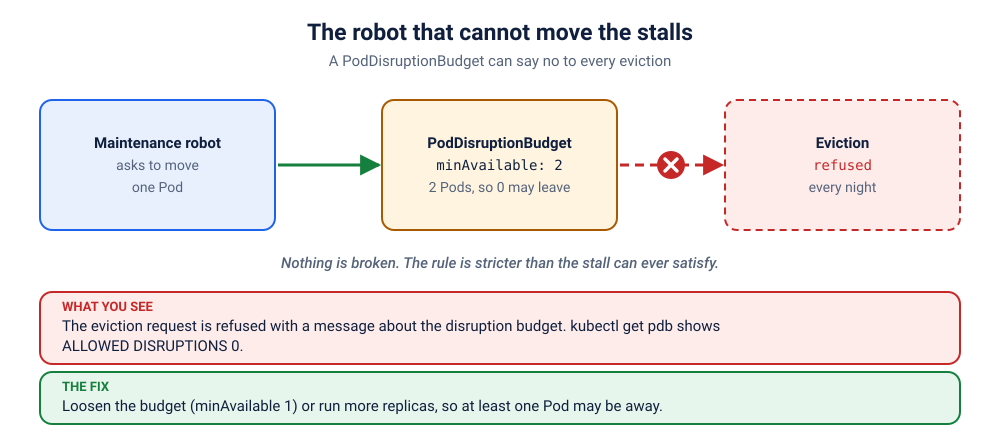

# S5.x4 · The robot that cannot move the stalls

*Every night the maintenance robot asks to move one Pod. Every night the answer is no.*

⏱ 15 min · intermediate · Idli stall (`hashicorp/http-echo`, about 17 MB) · PodDisruptionBudget, the Eviction API, what `kubectl drain` really does, evict vs delete

⬇️ First run downloads about 17 MB (the stall) plus a tiny 4 MB visitor image. A slow first download is normal: do it on good Wi-Fi, before the session.

Output columns and wording can differ a little between kubectl versions and clusters (kind, minikube, Docker Desktop, playgrounds). The ideas never change.

> 🧭 **New topic: safe maintenance.** On your own cluster `kubectl drain` would empty a whole node, which is not something to try on a one-node Docker Desktop or minikube. So this scenario sends the *same request* `drain` sends, but for one Pod: safe on any cluster.

## 📖 The story
Meera's idli stall runs two Pods, and a safety rule says: "at least 2 must always be open". Sensible. Nobody wants the idlis to disappear during breakfast.

Every night a maintenance robot needs to move one stall to a new home (this is what happens when a machine is taken out for maintenance). Every night the robot is refused. The platform team says the robot is broken. The app team says the safety rule is working perfectly. They are both right, which is the most annoying way to be right.



## 🧠 The concept: why, what, how



Pods get disrupted in two ways:
- **Involuntary:** a machine dies. You cannot stop that.
- **Voluntary:** somebody *chooses* to move Pods, for node maintenance, a cluster upgrade, or the autoscaler removing a node.

A **PodDisruptionBudget (PDB)** is a safety rule for voluntary moves: "keep at least N Pods up" (`minAvailable`) or "never take more than N away" (`maxUnavailable`).

`kubectl drain` moves Pods by asking the API to **evict** each one. The API checks the PDB and **refuses** an eviction that would break the rule. A refused drain simply waits and tries again.

The sum that matters: **allowed disruptions = healthy Pods − minAvailable**. With 2 healthy Pods and `minAvailable: 2`, the answer is 0: the rule allows nothing, ever. That is not a safety rule any more, it is a locked door.

```
 robot ──▶ "evict idli-xxx" ──▶ PDB: 2 healthy, need 2, allowed 0 ──▶ ✖ refused (every night)
```


## 🔮 Predict first (60 seconds)
Two idli Pods, and a rule that says `minAvailable: 2`.
1. How many Pods may the robot move at the same time?
2. If, instead of asking the robot, you simply ran `kubectl delete pod` on one of them, what do you think happens? Keep your guess for later.

<details><summary>Check your prediction</summary>

1. None. 2 healthy minus 2 required is 0.
2. You will test it for real shortly: it is the interesting part.
</details>

## 💥 Break it
```bash
cd break && python3 run.py
```
The idli stall is up and the visitor is happy. Now send the robot in. It lives one folder up:
```bash
cd .. && ./evict.sh
```
Expect a refusal along the lines of *cannot evict pod as it would violate the pod's disruption budget* (the exact wording varies by version). The stall carries on serving idlis meanwhile:
```bash
kubectl logs -f visitor -n k-39-idli-robot
```
(Ctrl+C to stop.)

## 🔍 Investigate: you drive
**Q1. What did the robot actually say?** Read the refusal slowly, to the end.
<details><summary>💡 Hint</summary>
It names the thing that said no. What kind of object is it, and what is it called?
</details>

**Q2. What does that object say about how many Pods can move?**
<details><summary>💡 Hint</summary>

```bash
kubectl get pdb -n k-39-idli-robot
```
Look at the `ALLOWED DISRUPTIONS` column.
</details>

**Q3. Why is it zero? Do the sum.**
<details><summary>💡 Hint</summary>

```bash
kubectl get pdb idli-pdb -n k-39-idli-robot -o yaml
kubectl explain pdb.spec.minAvailable
```
Compare `minAvailable` with how many Pods exist and are healthy (`currentHealthy` under `status`).
</details>

## 🪤 The tempting wrong fix: delete the Pod yourself
"The robot is stuck. I will just do it by hand."
```bash
POD=$(kubectl get pods -n k-39-idli-robot -l app=idli -o name | head -1)
kubectl delete $POD -n k-39-idli-robot
kubectl get pods -n k-39-idli-robot
```
It works instantly. The Pod goes, and the Deployment opens a replacement. So much for the safety rule? No: **a PDB only guards evictions**, and a plain `delete` is not an eviction, so it walks straight past the rule. That is exactly why people cause outages with `kubectl delete`: nothing checked that the *other* Pods were healthy first. It works, and it is the habit a PDB exists to prevent.

## 🩺 Root cause
<details><summary>Reveal after the room guesses</summary>

The PDB says `minAvailable: 2`, and the Deployment has exactly 2 Pods. So the number of Pods allowed to be away is 2 − 2 = 0. Every eviction, including the ones `kubectl drain` sends, would break the rule, so every one is refused. Nothing is broken: the rule is simply too strict for a stall of this size.
</details>

## 🔧 Fix it
```bash
cd ../fix && python3 run.py
```
The reference fix loosens the rule to `minAvailable: 1`: keep at least one stall open, and allow one to move. There are other good answers, and which one you pick is a real design decision:
- **`maxUnavailable: 1`**: say it the other way round. Same effect here.
- **Run 3 replicas and keep `minAvailable: 2`**: you can move one *and* still have two serving. The safest for customers, but it costs one more Pod.

`./check.sh` accepts any of them.

## ✅ Verify it yourself
```bash
cd .. && ./check.sh
./evict.sh
```
The checker looks at the rule. Then send the robot in again: this time it should succeed, and the Deployment opens a replacement straight away.

## 🎯 Key takeaways
- **A PDB protects *voluntary* disruptions** (drain, upgrades, autoscaler). It does nothing for crashes.
- **Allowed disruptions = healthy Pods − `minAvailable`.** If that is 0, drains will hang.
- **`kubectl drain` uses the Eviction API**, and the PDB can refuse it. A plain `kubectl delete` ignores the PDB.
- **A rule that allows nothing is not a safety rule.** Leave room to move one Pod.

## 💎 Lifelong lesson
> A safety rule that allows nothing is a locked door, not a safety rule.

## 🏢 Where you'll meet this at work
- **A node upgrade that hangs forever** on a Pod whose PDB allows zero disruptions (platform team, every upgrade season).
- **The cluster autoscaler not scaling down** because a Pod "cannot be moved" (SRE).
- **`minAvailable: 100%`** copied into a Helm chart "to be safe" (developer, with the best intentions).

## 🧹 Clean up
```bash
./cleanup.sh
```

## Next →
Back to the [scenarios](../../../README.md), or revisit [S1.x1](../../../1-architecture-and-pod-lifecycle/exercises/1-ai-trainer-needs-gpu/README.md) and [S1.x2](../../../1-architecture-and-pod-lifecycle/exercises/2-whoami-anti-affinity/README.md) to see how the scheduler decides where Pods land.
