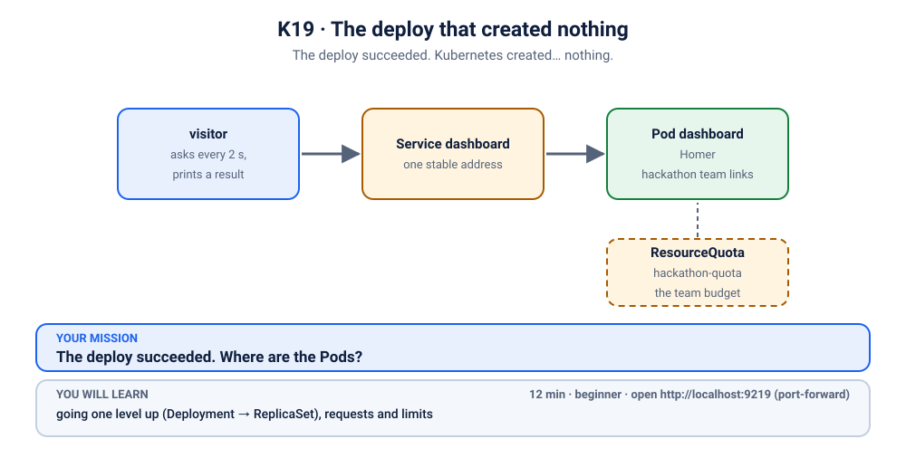
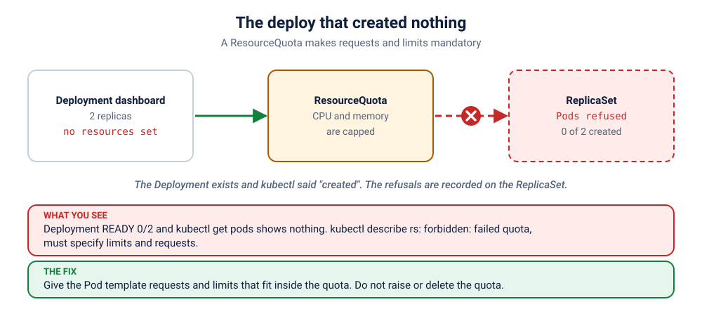

# S6.2 · The deploy that created nothing

*The deploy succeeded. Kubernetes created… nothing.*

⏱ 12 min · beginner · "Hackathon team links" page (Homer dashboard, `b4bz/homer:v25.10.1`) · going one level up (Deployment → ReplicaSet), requests and limits

⬇️ The tiny 4 MB visitor image downloads when you break it. The Homer image (about 7 MB) downloads only at fix time, because no dashboard Pod exists while it is broken. That is quick, even on slow Wi-Fi. Presenters: preload it (`kubernetes/scenarios/preload.sh`) if you like.

Output columns and wording can differ a little between kubectl versions and clusters (kind, minikube, Docker Desktop, playgrounds). The ideas never change.

## 📖 The story
It is 2 AM at the BengaluruBuild 24-hour hackathon. Lakshmi from the organising team has built a "Hackathon team links" page, so every team can find the judges' scoring sheet, the demo order and the Wi-Fi password in one place. Ravi deploys it to the hackathon namespace that the organisers set up yesterday. `kubectl` says `deployment.apps/dashboard created`. Green. Everyone relaxes. But the page is not there, and a small visitor who checks it every few seconds keeps getting no answer. Strangely, there is no crashing Pod, no `Pending` Pod, no error Pod. Where did the Pods go?



## 🧠 The concept: why, what, how



A shared cluster is like a shared hostel kitchen: if one team switches on every burner, nobody else gets to cook. Platform teams prevent that with budgets per namespace:

- A **ResourceQuota** is a budget for a whole namespace: "all Pods together may *request* at most 500m of CPU and 256Mi of memory, and may be *limited* to at most 1 CPU and 512Mi".
- A Pod states its needs with **requests** (what it asks the scheduler to reserve) and **limits** (the ceiling it may not exceed).
- Here is the surprise: once a quota covers CPU or memory, **every Pod in that namespace must declare the numbers the quota counts** (a quota on `requests.cpu` alone would only need that one request). The quota can't count what a Pod doesn't say, so it refuses the Pod.
- And the refusal happens at the door: the API server says no *before the Pod exists*. A Pod that was never created can't be `Pending` or `Failed`. It just isn't there.
- Who tries to create the Pods? Not you. A Deployment creates a **ReplicaSet**, and the ReplicaSet creates the Pods. So the complaint is written on the ReplicaSet.

```
 kubectl apply ──▶ Deployment ──▶ ReplicaSet ──▶ "create a Pod, please" ──▶ quota check ──▶ Pod
                                      ▲                                          │
                                      └───── "forbidden: failed quota" ◀─────────┘   (no Pod is ever made)
```

## 🏢 Where you'll meet this at work
- **One cluster, many teams.** The platform team gives each team a namespace with a quota so one noisy team can't eat the cluster (platform team, SRE).
- **A new deploy to an old namespace.** The app worked in dev (no quota) and "mysteriously" creates nothing in the team namespace (developer).
- **Cost control.** Cloud bills follow the CPU and memory you reserve; quotas keep a runaway `replicas: 500` from becoming a surprise invoice (FinOps, platform team).

## 💥 Break it
```bash
cd break && python3 run.py
```
What the room should see: the script sets up the namespace, deploys the dashboard and finishes without any error. A small `visitor` Pod, which asks for the page every few seconds, gets no answer:
```bash
kubectl logs -f visitor -n k-19-hackathon
```
```
❌ 19:53:09 no answer from http://dashboard
❌ 19:53:12 no answer from http://dashboard
```
(Times will differ.) You can stop it with Ctrl+C. We'll watch it again live when we fix things. (The visitor itself *does* run: it declares its own numbers, and we'll see why.)

## 🔮 Predict first (60 seconds)
The namespace has a quota, and the Pod template declares no resources. Before you look:
1. Does the Deployment have any Pods?
2. Where will the error appear?

<details><summary>Check your prediction</summary>

1. No: it shows `0/2`.
2. On the **ReplicaSet**, not the Deployment: the refusal happens when the ReplicaSet tries to create a Pod.
</details>

## 🔍 Investigate
Guess first, then run these **in order**. The visitor's log already told us the symptom: nobody answers.

**1. Did the Deployment get what we asked for?** Start at the top: we asked for 2 replicas.
```bash
kubectl get deployment dashboard -n k-19-hackathon
```
```
NAME        READY   UP-TO-DATE   AVAILABLE   AGE
dashboard   0/2     0            0           8s
```
(Ages will differ.) We wanted 2, we have 0. Not "1 of 2" and not "restarting": zero.

**2. So where are the Pods?** The usual next step is to look at them and describe the broken one.
```bash
kubectl get pods -n k-19-hackathon
```
```
NAME      READY   STATUS    RESTARTS   AGE
visitor   1/1     Running   0          8s
```
Only the `visitor` is listed. **There is no dashboard Pod at all**, so there is nothing to `describe` and no logs to read. This is the moment most people get stuck.

<details><summary>💡 Hint</summary>
When there are no Pods to describe, go <em>one level up</em>. A Deployment doesn't create Pods itself: it hires something else to do it. Find that object, and read what it says. Whoever tried (and failed) to make the Pods will have written down why.
</details>

**3. Who is supposed to make the Pods?** The Deployment hands the job to a ReplicaSet. Look at it.
```bash
kubectl get rs -n k-19-hackathon
```
```
NAME                   DESIRED   CURRENT   READY   AGE
dashboard-54b867d6f4   2         0         0       8s
```
(The name suffix will differ.) The ReplicaSet **desires 2** and **has 0**. It is trying and failing to create Pods. It keeps a diary of that.

**4. What does the ReplicaSet say?** Read its events: the reason is here.
```bash
kubectl describe rs -n k-19-hackathon
```
```
Conditions:
  Type             Status  Reason
  ----             ------  ------
  ReplicaFailure   True    FailedCreate
Events:
  Type     Reason        Age   From                   Message
  ----     ------        ----  ----                   -------
  Warning  FailedCreate  8s    replicaset-controller  Error creating: pods "dashboard-54b867d6f4-ctfbw" is forbidden: failed quota: hackathon-quota: must specify limits.cpu for: homer; limits.memory for: homer; requests.cpu for: homer; requests.memory for: homer
  Warning  FailedCreate  8s    replicaset-controller  Error creating: pods "dashboard-54b867d6f4-drwrf" is forbidden: failed quota: hackathon-quota: must specify limits.cpu for: homer; limits.memory for: homer; requests.cpu for: homer; requests.memory for: homer
```
(shortened: the real output has many more lines, because the ReplicaSet retries, and a long `Pod Template` block above. Names and ages will differ. The wording can differ a little between Kubernetes versions: the key phrases are `forbidden: failed quota` and `must specify`.) There it is: the Pod was **forbidden**, by a quota named `hackathon-quota`, because the container `homer` didn't say how much CPU and memory it needs.

**5. What is this quota, and how much is left?** The event named it. Ask the namespace about its budget.
```bash
kubectl describe quota -n k-19-hackathon
```
```
Name:            hackathon-quota
Namespace:       k-19-hackathon
Resource         Used  Hard
--------         ----  ----
limits.cpu       50m   1
limits.memory    16Mi  512Mi
requests.cpu     10m   500m
requests.memory  8Mi   256Mi
```
There is plenty of budget left. Only the visitor uses a little (`Used`): so it is **not** about running out. It is about the Pods not stating their numbers. (And look: the visitor stated its own numbers, which is why it was allowed in. Check with `kubectl get pod visitor -n k-19-hackathon -o yaml | grep -A8 resources`.)

## 🪤 The tempting wrong fix: restart the rollout
"Kick it again."
```bash
kubectl rollout restart deployment dashboard -n k-19-hackathon
kubectl get deployment,rs -n k-19-hackathon
```
A new ReplicaSet appears and is refused for exactly the same reason. A restart does not change what the Pod template says, and the quota still demands requests and limits.

## 🩺 Root cause
<details><summary>Reveal after the room guesses</summary>

The namespace has a ResourceQuota that covers CPU and memory. Because of that, the API server only accepts a Pod that declares `requests` and `limits` for both. The `dashboard` Deployment's Pod template declares none, so every time the ReplicaSet asks for a Pod the request is refused (`forbidden: failed quota … must specify …`) and no Pod is ever created. The refusal shows up as `FailedCreate` events on the ReplicaSet and as `ReplicaFailure` on the Deployment: not on any Pod, because there is no Pod. Nothing is wrong with the image, the config page or the Service.
</details>

## 🔧 Fix it
Before you run it, open a **second terminal** and start the live visitor log, so the room sees red turn green:
```bash
kubectl logs -f visitor -n k-19-hackathon
```
Then, in the first terminal:
```bash
cd ../fix && python3 run.py
```
Within about half a minute the log flips from ❌ to ✅ lines (Ctrl+C to stop it):
```
❌ 19:53:27 no answer from http://dashboard
✅ 19:53:29 HTTP 200
✅ 19:53:31 HTTP 200
```
(shortened.) What changed:
```bash
diff ../break/app.yaml app.yaml
```
```
1c1,2
< # S6.2 break (3/4): the dashboard (Homer).
---
> # S6.2 fix: the same dashboard, now with requests and limits that fit inside the quota.
> # Two replicas x (50m CPU, 32Mi) = 100m CPU, 64Mi in requests; the quota allows 500m / 256Mi.
21a23,29
>           resources:
>             requests:
>               cpu: 50m
>               memory: 32Mi
>             limits:
>               cpu: 100m
>               memory: 64Mi
```
The Pod template changed, so the Deployment created a **new** ReplicaSet, and this one's Pods are allowed in. (The old, empty ReplicaSet stays around with 0 Pods; that is the Deployment's rollback history.)

By hand (this replaces `./fix.sh`, so you don't need to run both): from the `fix` folder, apply the corrected file.
```bash
kubectl apply -f app.yaml
```

**Why add resources, and not raise the quota?** You *could* ask for a bigger quota, but here the budget was never the problem: the dashboard asks for very little (50m CPU and 32Mi per Pod), and the quota has room for many more. A quota is the platform team's decision, and the app team's job is to say what its Pods need. If the numbers truly don't fit, that is a conversation about the budget, not a reason to remove it. A platform team has another option: a **LimitRange** fills in default requests and limits for containers that omit them, so the quota would admit them. This namespace has none, which is why the Pods were refused; [S6.5](../5-surprise-limitrange-oom/README.md) shows the surprising side of a LimitRange. Whatever the source, keep the limits modest but not tiny: a Pod that tries to use more memory than its limit gets killed (you will meet exactly that in S5.5).

## ✅ Verify it yourself
Short on time? `cd .. && ./check.sh` says in one line whether you are done. It only looks, it never changes anything. The steps below show you *why* it says so.

```bash
kubectl get deployment,pods -n k-19-hackathon
```
```
NAME                        READY   UP-TO-DATE   AVAILABLE   AGE
deployment.apps/dashboard   2/2     2            2           26s

NAME                             READY   STATUS    RESTARTS   AGE
pod/dashboard-589cd69b75-f4m6d   1/1     Running   0          7s
pod/dashboard-589cd69b75-sph5t   1/1     Running   0          5s
pod/visitor                      1/1     Running   0          26s
```
(Names and ages will differ.) The Pods exist now, and `2/2` are ready. The budget shows what they use:
```bash
kubectl describe quota -n k-19-hackathon
```
```
Name:            hackathon-quota
Namespace:       k-19-hackathon
Resource         Used   Hard
--------         ----   ----
limits.cpu       250m   1
limits.memory    144Mi  512Mi
requests.cpu     110m   500m
requests.memory  72Mi   256Mi
```
`requests.cpu` is 110m: 2 dashboard Pods × 50m, plus the visitor's 10m. The visitor's log is green (if you still see a ❌, wait a few seconds and run it again):
```bash
kubectl logs visitor -n k-19-hackathon --tail=3
```
```
✅ 19:53:37 HTTP 200
✅ 19:53:39 HTTP 200
✅ 19:53:41 HTTP 200
```
Now open the page yourself. In a **second terminal** (leave it running):
```bash
kubectl port-forward -n k-19-hackathon svc/dashboard 9219:80
```
```
Forwarding from 127.0.0.1:9219 -> 8080
Forwarding from [::1]:9219 -> 8080
```
On a playground, add `--address 0.0.0.0` and open the URL for port 9219.
Back in the first terminal:
```bash
curl -s -o /dev/null -w '%{http_code}\n' localhost:9219
```
```
200
```
(The port-forward terminal also prints `Handling connection for 9219`.) Or open http://localhost:9219 in your browser and see the "Hackathon team links" page: the teams, the judges' corner and the survival kit. Press Ctrl+C in the second terminal to stop the port-forward.

**Try it yourself (optional).** The quota applies to *every* Pod in the namespace, even a quick test Pod:
```bash
kubectl run test -n k-19-hackathon --image=busybox:1.36 --command -- sleep 60
```
It is refused with the same `failed quota … must specify` message, right at your terminal, because no ReplicaSet sits in between to hide the error (the exact wording can differ by version). That is why the `visitor` Pod in this scenario declares its own requests and limits.

## 👀 See it in monitoring (optional)
If you installed the monitoring stack ([lab K19](../../../19-observability/README.md)), watch a quota that is nearly spent as a number. In Prometheus (`kubectl port-forward -n monitoring svc/kube-prometheus-stack-prometheus 9090:9090`, then http://localhost:9090) run:
```
kube_resourcequota{namespace="k-19-hackathon"}
```
Each quota gives a `hard` (the limit) and a `used` series per resource. A team that watches `used / hard` knows the quota is about to bite before a deploy creates nothing.

## 🎯 Key takeaways
- **A quota is a budget for a namespace.** Once it covers CPU or memory, every Pod there must declare `requests` and `limits`, and all of them together must fit.
- **Refused Pods are never created.** The "no" comes from the API server, so there is no Pod to describe. The evidence lives on the **ReplicaSet** (`FailedCreate` events) and shows as `ReplicaFailure` on the Deployment.
- **The investigation path:** `get deploy` (0/2) → `get pods` (none) → `get rs` → `describe rs` (the reason) → `describe quota` (the budget).
- Fix it on the side you own: tell Kubernetes what your Pods need. The budget itself is the platform team's call.

## 💎 Lifelong lesson
> When there are no Pods to describe, go one level up.

## 🧹 Clean up
Press Ctrl+C in the port-forward terminal first, then:
```bash
cd .. && ./cleanup.sh
```

## 🧪 Quick recap (3 questions)
1. Why are there no Pods at all?
2. Where do you look when a Deployment shows `0/2`?
3. What does the Pod template need?

<details><summary>Answers</summary>

1. The quota's admission check refused to create them.
2. One level up: `kubectl describe rs` (the ReplicaSet's events).
3. `requests` and `limits` for the resources the quota covers.
</details>

## Next →
Next, in this section: [S6.3](../3-upgrade-that-broke-the-stall/README.md): Helm said "deployed". Helm was not lying. Helm was not helping either.
