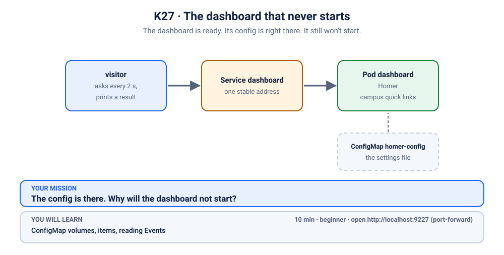
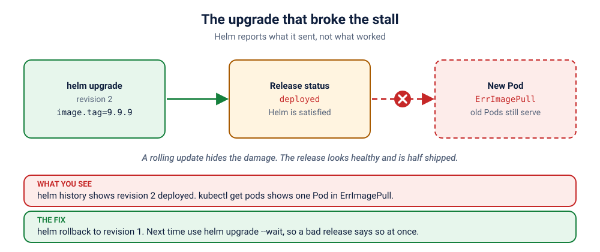

# S6.3 · The upgrade that broke the stall

*Helm said "deployed". Helm was not lying. Helm was not helping either.*

⏱ 15 min · intermediate · A biryani stall installed with Helm (`http-echo`, 17 MB) · Helm releases, `helm history`, `helm rollback`, why "deployed" is not "working"

⬇️ Nothing big: the 17 MB `hashicorp/http-echo` image and the 4 MB busybox visitor. Needs `helm` installed.

Output columns and wording can differ a little between kubectl versions and clusters (kind, minikube, Docker Desktop, playgrounds). The ideas never change.

> 🧭 **Section 6, "Namespaces, Helm and troubleshooting"**. Previous: [S6.2](../2-hackathon-quota/README.md). Next: [S6.4](../4-two-stalls-one-signboard/README.md).

## 📖 The story
The biryani stall is installed with **Helm**, the package manager of Kubernetes: one command made the Deployment and the Service, and Helm keeps a numbered history of every change (a **release** with **revisions**). Today a developer ships "version 2" with `helm upgrade`. Helm prints `Release "stall" has been upgraded` and moves on. The customers, thanks to a polite rolling update, still get their biryani. But half the stall is stuck at the door, and Helm believes everything is fine.

## 🏆 Rules of this one
- **Helm is a messenger.** It reports that it *sent* the change, not that the change *worked*.
- **Start with the history, then the Pods.**



## 🧠 The concept



A **chart** is a package of templates; a **release** is one installed copy of it in a cluster; every `helm upgrade` makes a new **revision**. `helm install` and `helm upgrade` return as soon as Kubernetes has *accepted* the objects, unless you add `--wait`. Whether the Pods then become healthy is Kubernetes' business.

| Command | What it shows or does |
|---|---|
| `helm list -n NS` | the releases in a namespace and their status |
| `helm history NAME -n NS` | every revision, and what happened to it |
| `helm get values NAME -n NS` | the settings you changed |
| `helm rollback NAME REV -n NS` | go back to a good revision (this makes a *new* revision) |
| `helm upgrade --wait` | do not report success until the Pods are Ready |

## 🔮 Predict first
Helm just reported the upgrade as "deployed". Does that mean the new version is running? What do you expect `kubectl get pods` to show? Write it down.

<details><summary>Check your prediction</summary>

Not necessarily. "Deployed" means Kubernetes accepted the new objects. Here a new Pod cannot pull its image (`ErrImagePull`), while the two old Pods keep serving, so customers notice nothing yet. A release can be "deployed" and broken at the same time.
</details>

## 💥 Break it
```bash
cd break && ./break.sh
```
```bash
helm list -n k-27-helm
helm history stall -n k-27-helm
kubectl logs -f visitor -n k-27-helm
```
Stop the logs with Ctrl+C.

## 🔍 Investigate: you drive
**What is the first thing you look at?**
<details><summary>💡 Tier 1: a nudge</summary>
Compare what Helm says with what Kubernetes says. Then ask Helm what changed between revisions.
</details>
<details><summary>💡 Tier 2: the commands</summary>

```bash
kubectl get pods -n k-27-helm
helm get values stall -n k-27-helm
kubectl describe pod -n k-27-helm -l app=stall | grep -A4 "Failed\|Events"
```
</details>
<details><summary>💡 Tier 3: the answers to look for</summary>

Helm lists revision 2 as `deployed`. The values show `image.tag: 9.9.9`. One Pod is in `ErrImagePull` / `ImagePullBackOff` because that tag does not exist. The two old Pods keep serving because the rolling update never removed them.
</details>

## 🪤 The tempting wrong fix
Run another `helm upgrade` with a "better guess" for the tag, hoping one works. Or delete the broken Pod and watch it come back broken. The previous revision *worked*: **go back to something that works first, then investigate.** (A `helm upgrade --set image.tag=1.0.0` would also work, but `helm rollback` is one command with no guessing.)

## 🩺 Root cause
<details><summary>Reveal after the room guesses</summary>

The upgrade changed `image.tag` to `9.9.9`, an image that does not exist. `helm upgrade` without `--wait` returned as soon as Kubernetes accepted the change, so Helm recorded "deployed". The rolling update could not finish, but it also could not remove the old Pods, so nothing visibly broke: a half-shipped release.
</details>

## 🔧 Fix it
```bash
cd ../fix && ./fix.sh
```
The reference fix is `helm rollback stall 1 -n k-27-helm --wait`. Helm creates revision 3 with revision 1's settings. `helm history` now shows the whole story. Next time use `helm upgrade --wait --timeout 2m`, so a bad release says so at once.

## ✅ Verify it yourself
```bash
cd .. && ./check.sh
```
It checks that the Deployment runs the good image again, every Pod is Ready, and the visitor sees ✅.

## 🎯 Key takeaways
- **"Deployed" is not "working".** Helm reports what it sent. Use `--wait`.
- **`helm history` is the audit trail.** Read it first.
- **Roll back first, investigate second.** A release is cheap to undo.
- **A rolling update protects customers from a bad release**, but also hides it.

## 💎 Lifelong lesson
> A messenger tells you the letter was delivered. It does not tell you it was read.

## 🏢 Where you'll meet this at work
- **A CI pipeline that is green** because `helm upgrade` returned 0, while the new Pods crash-loop (everyone).
- **On-call runbooks** that start with `helm history` and end with `helm rollback` (platform team).

## 🧹 Clean up
```bash
./cleanup.sh
```

## Next →
Next, in this section: [S6.4](../4-two-stalls-one-signboard/README.md): Some customers get hot chai. Some get… yesterday's.
