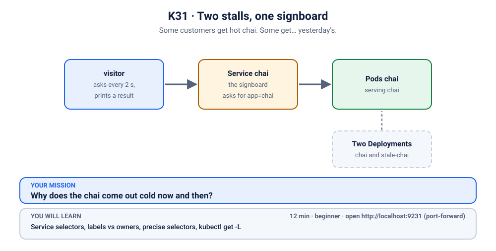
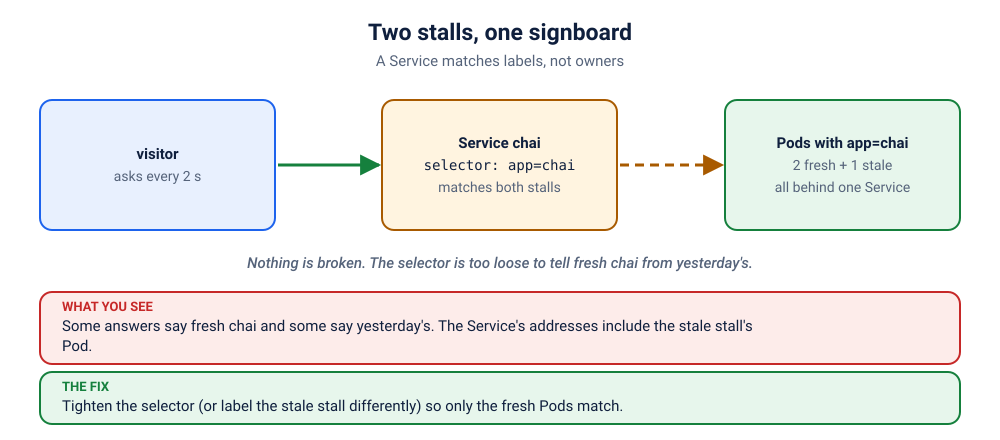

# S6.4 · Two stalls, one signboard

*Some customers get hot chai. Some get… yesterday's.*

⏱ 12 min · beginner · Chai stall (`hashicorp/http-echo`, about 17 MB) · Service selectors, labels vs owners, precise selectors, `kubectl get -L`

⬇️ First run downloads about 17 MB (the stall) plus a tiny 4 MB visitor image. A slow first download is normal: do it on good Wi-Fi, before the session.

Output columns and wording can differ a little between kubectl versions and clusters (kind, minikube, Docker Desktop, playgrounds). The ideas never change.

> 🧭 **Section 6, "Namespaces, quotas, Helm and troubleshooting".** Labels and annotations. [S3.1](../../3-services-ingress-and-networking/1-it-tools-no-endpoints/README.md) showed a Service finding its Pods by label; here the label is *too loose*. Fewer hints than the first scenarios.

## 📖 The story
Priya runs the website for the campus chai stall. It is wonderfully simple: one signboard (a **Service**) that says "Chai here →" and points at every stall wearing the `chai` badge.

Last week Ravi opened a second stall, `stale-chai`, to test a new recipe. The test ended on Friday. The stall did not. Now every third customer is handed a cup from the day before, which is a very specific way to learn about Kubernetes. Nobody touched the signboard. Nobody had to: it will happily point at anything wearing the right badge.



## 🧠 The concept: why, what, how



A Service has no idea which Deployment made a Pod. It knows one thing: a **label query**. "Send customers to every Ready Pod wearing *all* of these labels." Whoever created the Pod, wherever it came from, if the badge matches, it is in.

- **Labels belong to Pods, not to their owners.** A leftover test Pod with the right label is a full member of the team.
- **A loose selector is a wide net.** `app: chai` catches every chai Pod. `app: chai` plus `track: fresh` catches only the ones you mean.
- This is also how blue/green and canary releases work *on purpose*: you change who matches.

```
                        ┌──▶ Pod  chai-…        app=chai  track=fresh   ✅
 customer ──▶ Service ──┼──▶ Pod  chai-…        app=chai  track=fresh   ✅
 (app=chai)             └──▶ Pod  stale-chai-…  app=chai  track=stale   🥶  also matches!
```

## 🔮 Predict first (60 seconds)
Say these out loud before you run anything:
1. How many addresses do you expect behind the Service `chai`?
2. If 30 customers walk up, roughly how many get the cold chai?

<details><summary>Check your prediction</summary>

Three addresses: two fresh Pods and one stale. A Service shares customers across *addresses*, not across Deployments, so the stale stall gets about a third of them: roughly 10 of 30. The balancing is random-ish, so "roughly" is the honest word.
</details>

## 💥 Break it
```bash
cd break && python3 run.py
```
The script finishes happily: two Deployments, one Service, one visitor. Watch the visitor in a second terminal:
```bash
kubectl logs -f visitor -n k-31-two-stalls
```
```
✅ 14:02:11 ☕ Fresh chai, extra ginger!
✅ 14:02:13 ☕ Fresh chai, extra ginger!
✅ 14:02:15 🥶 Yesterday's chai. Cold. Sorry.
```
(An illustration: the order and times will differ. Notice there is no ❌ here. Everything "works". That is what makes this one sneaky.) Stop it with Ctrl+C.

## 🔍 Investigate: you drive
Three questions. Try each one yourself first, and open a hint only when you are stuck. The commands are in the hints, but the thinking is yours.

**1. Who is wearing the `chai` badge?** How many Pods, and which Deployment made each?
<details><summary>💡 Hint 1</summary>
Pods carry labels, and <code>kubectl get</code> can show a label as its own column. Look for a flag with a capital L.
</details>
<details><summary>💡 Hint 2: the command</summary>

```bash
kubectl get pods -n k-31-two-stalls -L app,track
```
You should see three `chai` Pods and one `visitor`. Two of the chai Pods say `track=fresh` and one says `track=stale`.
</details>

**2. What does the Service actually ask for?**
<details><summary>💡 Hint</summary>

```bash
kubectl get service chai -n k-31-two-stalls -o wide
```
Read the `SELECTOR` column. How many labels does it ask for?
</details>

**3. Turn the Service's question into your own question.** Which Pods match it?
<details><summary>💡 Hint</summary>

A selector is just a label query, and you can run the same query yourself:
```bash
kubectl get pods -n k-31-two-stalls -l app=chai -L track
```
Count the rows. That count is the number of addresses behind the Service.
</details>

## 🪤 The tempting wrong fix
"The cold one is the problem. Delete it!"
```bash
kubectl delete pod -n k-31-two-stalls -l track=stale
kubectl get pods -n k-31-two-stalls -L track
```
Run it, then look again. Within seconds a brand-new `stale-chai` Pod is back. Its Deployment saw a missing Pod and did its job. You are playing whack-a-mole with a controller that never gets tired. Deleting a Pod fixes a symptom. The *signboard* is what needs attention.

## 🩺 Root cause
<details><summary>Reveal after the room guesses</summary>

The Service selects only `app: chai`. Both Deployments stamp that label on their Pods, so the stale stall's Pod is a legitimate match and receives a third of the traffic. Nothing is broken in Kubernetes: the selector is simply too loose to tell fresh from stale. Services match labels, not owners.
</details>

## 🔧 Fix it
Open a second terminal on the visitor log, so the room watches the cold chai disappear:
```bash
kubectl logs -f visitor -n k-31-two-stalls
```
Then apply the reference fix, which makes the signboard more precise (`app: chai` **and** `track: fresh`):
```bash
cd ../fix && python3 run.py
```
Prefer to do it by hand? Either of these works, and `./check.sh` will agree with both:
```bash
# Option A: make the selector precise
kubectl patch service chai -n k-31-two-stalls --type merge -p '{"spec":{"selector":{"track":"fresh"}}}'

# Option B: retire the stale stall (right if nobody needs it any more)
kubectl delete deployment stale-chai -n k-31-two-stalls
```
Which is better? A is safer when the second stall is *supposed* to exist (a canary, say). B is right when it is just a forgotten leftover. Knowing which one you are dealing with is the real skill.

## ✅ Verify it yourself
```bash
cd .. && ./check.sh
```
A green message means every address behind the Service is fresh. The visitor log should now show only ☕.

## 🎯 Key takeaways
- **A Service finds Pods by labels, never by owner.** Anything that matches is in.
- **A loose selector is a wide net.** Add a label that separates the things you want to separate.
- `kubectl get pods -L app,track` shows labels as columns, and `-l app=chai` runs the Service's own query.
- Deleting a Pod that a Deployment owns just gets you a new Pod.

## 💎 Lifelong lesson
> A Service trusts labels, not intentions.

## 🏢 Where you'll meet this at work
- **A forgotten canary or old version** still wearing the production label, quietly receiving real traffic (SRE, on-call).
- **A copy-pasted test Pod** with `app: web` stuck on it, joining the real pool (developer).
- **Helm releases or two teams** reusing the same `app` label in one namespace (platform team).

## 🧹 Clean up
```bash
./cleanup.sh
```

## Next →
Next, in this section: [S6.5](../5-surprise-limitrange-oom/README.md): "Nobody set a memory limit. The app still got killed for exceeding it."
