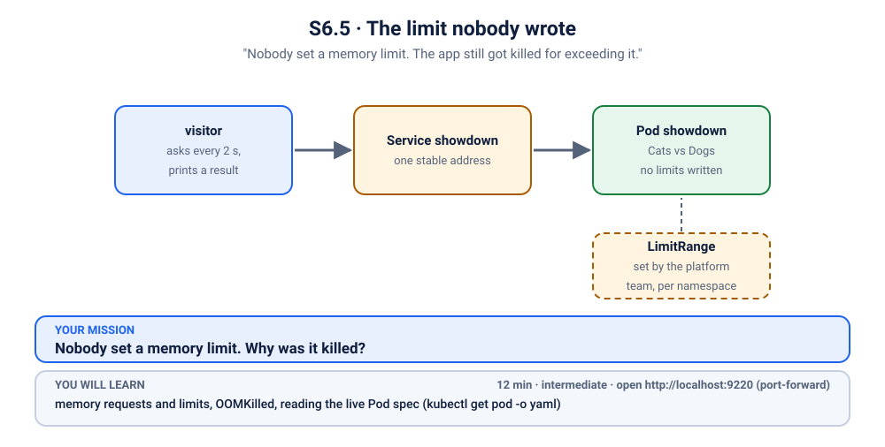
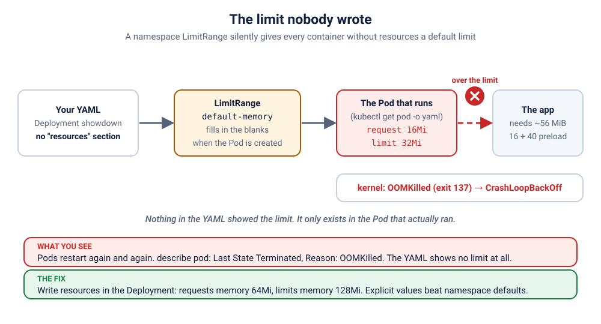

# S6.5 · The limit nobody wrote

*"Nobody set a memory limit. The app still got killed for exceeding it."*

⏱ 12 min · intermediate · Cats vs Dogs voting app (`python:3.12-alpine`, about 19 MB) · memory requests and limits, OOMKilled, reading the live Pod spec (`kubectl get pod -o yaml`), where unwritten settings come from

⬇️ First run downloads about 19 MB (Python) plus a tiny 4 MB visitor image. A slow first download is normal: do it on good Wi-Fi, before the session.

Output columns and wording can differ a little between kubectl, container runtimes and clusters (kind, minikube, Docker Desktop, playgrounds). The ideas never change.

## 📖 The story
Priya deploys the Cats vs Dogs poll for the department's fest into the shared `k-20-limitrange` namespace. Her YAML is tidy: image, port, readiness probe. She did not write a `resources:` section, because "it's a tiny Python app". Her teammate Ravi did the same thing last week in another team's namespace and it was fine. This time both Pods start, die, start, die... and Priya swears she never limited anything.



## 🧠 The concept: why, what, how
Every container can say two things about memory:
- **request:** "reserve at least this much for me." The scheduler uses it to pick a node.
- **limit:** "never let me use more than this." The Linux kernel enforces it. Go over, and the kernel kills the process on the spot: **OOMKilled**, exit code **137** (128 + signal 9).

A limit is a hard wall, not a polite warning, and the container gets no chance to log "I ran out". Think of a hotel room with a fixed number of beds: the 6th guest is not asked nicely to leave, the door is simply shut.

The app itself needs about 16 MiB. In this demo, its start command also loads a "vote history" into memory before the web server starts: 40 MiB of filler, standing in for the cache or dataset a real app would load. (We measured: plain `python:3.12-alpine` running this app idles at about 16 MiB, so we add that load on purpose, and the YAML says so in a comment.) With that load the whole Pod needs roughly 56 MiB (about 16 MiB plus the demo's 40 MiB preload).

## 🏢 Where you'll meet this at work
- **Shared clusters with guard rails:** platform teams give every namespace sensible defaults so one careless Pod cannot eat a node (platform team, SRE).
- **"It worked in staging":** the same YAML behaves differently in a namespace with different rules, and nobody sees that rule in the YAML (developer).
- **Every OOM post-mortem:** the first question is always "what limit did the Pod actually have?" (SRE, on-call).

## 💥 Break it
```bash
cd break && ./break.sh
```
What the room should see: the script deploys the app (2 replicas) and a small `visitor` Pod, waits until the app has started crashing, and stops. The visitor asks the app for `/healthz` every 2 seconds:
```bash
kubectl logs -f visitor -n k-20-limitrange
```
```
❌ 19:54:53 no answer from http://showdown/healthz
❌ 19:54:56 no answer from http://showdown/healthz
❌ 19:54:59 no answer from http://showdown/healthz
```
(Press Ctrl+C to stop.) Red, and staying red.

## 🔮 Predict first (60 seconds)
The YAML sets no memory limit, but the app is killed for exceeding one. Before you look:
1. Does the Deployment's YAML show a limit?
2. Where does the limit come from?

<details><summary>Check your prediction</summary>

1. No, none at all.
2. A LimitRange in the namespace, which filled in defaults when the Pod was created. It only shows in the Pod that actually ran.
</details>

## 🔍 Investigate
Guess first, then run these **in order**.

**1. Which Pods exist, and what are they doing?** Always start with the Pod list.
```bash
kubectl get pods -n k-20-limitrange
```
```
NAME                        READY   STATUS             RESTARTS     AGE
showdown-754579769b-frtw5   0/1     CrashLoopBackOff   2 (8s ago)   23s
showdown-754579769b-jg5cl   0/1     CrashLoopBackOff   2 (6s ago)   23s
visitor                     1/1     Running            0            23s
```
(Ages and Pod names will differ, and STATUS may read `OOMKilled` or `CrashLoopBackOff` depending on the moment you look.) Both app Pods restart again and again and are never Ready, so the Service has nobody to send visitors to. The visitor itself is fine.

<details><summary>💡 Hint</summary>
Why did the container die: did the app crash, or was it killed? Then a stranger question: look at what the Pod's spec says about memory, and compare it with what is written in the Deployment YAML you applied. Are they the same? If not, who wrote the difference?
</details>

**2. Why did the container die?** Ask for the last words in the Pod's description. Use a Pod name from step 1 (yours will differ).
```bash
kubectl describe pod showdown-754579769b-frtw5 -n k-20-limitrange | grep -A8 "Last State"
```
```
    Last State:     Terminated
      Reason:       OOMKilled
      Exit Code:    137
      Started:      Mon, 09 Nov 2026 01:24:51 +0530
      Finished:     Mon, 09 Nov 2026 01:24:51 +0530
    Ready:          False
    Restart Count:  2
    Limits:
      memory:  32Mi
```
(Your times and time zone will differ. On some container runtimes the reason shows as `Error` instead of `OOMKilled`; the exit code is still 137.) The kernel killed it for using too much memory, and the Pod has a limit of **32Mi**. Did anybody write that?

**3. What did the app say before it died?** A crash usually leaves a stack trace. Check the previous run's log.
```bash
kubectl logs showdown-754579769b-frtw5 -n k-20-limitrange --previous
```
(no output)

Nothing at all. An OOM kill is not an error message from the app: the kernel ends the process instantly, so the app never gets to print anything. (A real app may have logged some startup lines before it died. Here it is silent because the preload runs first.) That silence is itself a clue.

**4. What did *we* write about memory?** Look at the Deployment's own template.
```bash
kubectl get deployment showdown -n k-20-limitrange -o jsonpath='{.spec.template.spec.containers[0].resources}{"\n"}'
```
```
{}
```
Empty. The YAML we applied has no memory request and no limit.

**5. What did Kubernetes actually run?** The Pod object is the spec that really ran, so compare it with the line above.
```bash
kubectl get pod showdown-754579769b-frtw5 -n k-20-limitrange -o jsonpath='{.spec.containers[0].resources}{"\n"}'
```
```
{"limits":{"memory":"32Mi"},"requests":{"memory":"16Mi"}}
```
There it is: a `limits.memory` of 32Mi and a request of 16Mi, **which nobody wrote**. Something added them between our YAML and the running Pod. Look at the Pod's metadata for a signature:
```bash
kubectl get pod showdown-754579769b-frtw5 -n k-20-limitrange -o yaml | grep -A2 limit-ranger
```
```
    kubernetes.io/limit-ranger: 'LimitRanger plugin set: memory request for container
      showdown; memory limit for container showdown'
  creationTimestamp: "2026-11-08T19:59:34Z"
```
Kubernetes left a note: a "LimitRanger plugin" set the memory request and limit for our container. Where does it get its numbers from?

**6. Which object holds those numbers?** Look for it in the namespace.
```bash
kubectl get limitrange -n k-20-limitrange
```
```
NAME             CREATED AT
default-memory   2026-11-08T19:54:36Z
```
```bash
kubectl describe limitrange default-memory -n k-20-limitrange
```
```
Name:       default-memory
Namespace:  k-20-limitrange
Type        Resource  Min  Max  Default Request  Default Limit  Max Limit/Request Ratio
----        --------  ---  ---  ---------------  -------------  -----------------------
Container   memory    -    -    16Mi             32Mi           -
```
Found the author: a LimitRange called `default-memory`, with a default request of 16Mi and a default limit of 32Mi.

**7. Does it hit our other Pods too?** Any container without its own `resources` gets the defaults, including the visitor.
```bash
kubectl get pod visitor -n k-20-limitrange -o jsonpath='{.spec.containers[0].resources}{"\n"}'
```
```
{"limits":{"memory":"32Mi"},"requests":{"memory":"16Mi"}}
```
The visitor got the same defaults. Busybox needs only a few MiB, so it is perfectly happy, and so are the short-lived `curlimages/curl` Pods you may run to test (also well under 32Mi). Only our app (about 16 MiB plus the demo's 40 MiB preload) is too big.

## 🪤 The tempting wrong fix: restart the Pod
"There is no limit, so it must be a glitch."
```bash
kubectl delete pods -n k-20-limitrange -l app=showdown
kubectl get pods -n k-20-limitrange
```
The new Pod is admitted through the same LimitRange, gets the same invisible default, and is killed in the same way. The limit is not a glitch: it is applied every time.

## 🩺 Root cause
<details><summary>Reveal after the room guesses</summary>

The namespace has a **LimitRange** that gives every container without its own `resources` a default memory request of 16Mi and a default limit of 32Mi. Our Deployment sets no `resources`, so the API server quietly filled in 32Mi when it created each Pod. The app needs more than that at start (about 16 MiB plus the demo's 40 MiB preload), so the kernel kills it the moment it crosses 32Mi, over and over (CrashLoopBackOff). Nobody wrote the limit in the YAML, and nothing in the YAML showed it: it only appears in the Pod that actually ran.


</details>

## 🔧 Fix it
Before you run it, open a **second terminal** and start the live visitor log:
```bash
kubectl logs -f visitor -n k-20-limitrange
```
Then, in the first terminal:
```bash
cd ../fix && ./fix.sh
```
Watch the visitor go from ❌ to ✅ (Ctrl+C to stop it). There are two honest ways to fix this, and **who owns what decides which is right**:

| | Fix in the app (what we do) | Fix the LimitRange |
|---|---|---|
| Who | the **app team**, who know what the app needs | the **platform team**, who own the namespace rules |
| What | write `resources:` in the Deployment | change `default` / `defaultRequest` in the LimitRange |
| Right when | this one app genuinely needs more memory | many apps in the namespace hit the same default, or the default is too small for the namespace's normal workloads |
| Risk | none to others | affects every future Pod without its own `resources`, and can hide apps that forgot to set them |

We do the app team's fix, because one app needs more, and explicit values always beat the defaults (a LimitRange only fills in each missing value: set only a limit, and it still fills in the request).

Two LimitRange details worth knowing. In its YAML, the key `default` means the default **limit** and `defaultRequest` means the default **request** (as the `describe` columns showed). And defaults are applied only **when a Pod is created**: if the platform team edits the LimitRange, existing Pods keep what they got until they are recreated, for example with `kubectl rollout restart deployment/showdown -n k-20-limitrange`.

`fix.sh` applies the change below; here is exactly what is different from the broken file:
```bash
diff ../break/app.yaml app.yaml
```
```
37a38,42
>           resources:
>             requests:
>               memory: 64Mi
>             limits:
>               memory: 128Mi
```
(Run it from the `fix` folder; the comment lines differ, the real change is the five new lines.)

By hand (this replaces `./fix.sh`, so you don't need to run both):
```bash
kubectl apply -f app.yaml
kubectl rollout status deployment/showdown -n k-20-limitrange --timeout=180s
```

## ✅ Verify it yourself
Short on time? `cd .. && ./check.sh` says in one line whether you are done. It only looks, it never changes anything. The steps below show you *why* it says so.

```bash
kubectl get pods -n k-20-limitrange
```
```
NAME                       READY   STATUS    RESTARTS   AGE
showdown-5bfb9c79c-hsg25   1/1     Running   0          9s
showdown-5bfb9c79c-lhkzh   1/1     Running   0          10s
visitor                    1/1     Running   0          44s
```
(Ages and Pod names will differ. If you still see a ❌ in the visitor log, wait a few seconds.) Both app Pods are Ready with 0 restarts, and there are brand-new Pod names: the old ones were replaced. Now the spec Kubernetes actually ran:
```bash
kubectl get pods -n k-20-limitrange -l app=showdown -o jsonpath='{range .items[*]}{.metadata.name}{"  "}{.spec.containers[0].resources}{"\n"}{end}'
```
```
showdown-5bfb9c79c-hsg25  {"limits":{"memory":"128Mi"},"requests":{"memory":"64Mi"}}
showdown-5bfb9c79c-lhkzh  {"limits":{"memory":"128Mi"},"requests":{"memory":"64Mi"}}
```
Our values, not the defaults. The visitor, which we did not touch, still has 32Mi and is happy:
```bash
kubectl logs visitor -n k-20-limitrange --tail=3
```
```
✅ 19:55:15 HTTP 200
✅ 19:55:17 HTTP 200
✅ 19:55:19 HTTP 200
```
Now open it yourself. In a **second terminal** (leave it running):
```bash
kubectl port-forward -n k-20-limitrange svc/showdown 9220:80
```
```
Forwarding from 127.0.0.1:9220 -> 8080
Forwarding from [::1]:9220 -> 8080
```
On a playground, add `--address 0.0.0.0` and open the URL for port 9220.
Back in the first terminal:
```bash
curl -s localhost:9220/healthz
```
```
{"status": "alive", "served_by": "showdown-5bfb9c79c-lhkzh"}
```
Or open http://localhost:9220 in your browser and cast a vote. Press Ctrl+C in the second terminal to stop the port-forward.

## 👀 See it in monitoring (optional)
If you installed the monitoring stack ([lab K19](../../../19-observability/README.md)), watch a limit nobody wrote as a number. In Prometheus (`kubectl port-forward -n monitoring svc/kube-prometheus-stack-prometheus 9090:9090`, then http://localhost:9090) run:
```
container_memory_working_set_bytes{namespace="k-20-limitrange",container!=""} / on (namespace, pod, container) kube_pod_container_resource_limits{namespace="k-20-limitrange",resource="memory"}
```
Usage divided by limit climbs towards 1 and the Pod dies. The limit in that query is the one the LimitRange filled in, not one you wrote.

## 🎯 Key takeaways
- **A Pod can have a limit nobody wrote.** A LimitRange in the namespace fills in missing `resources` when the Pod is created.
- **An OOM kill is silent:** exit code 137, reason `OOMKilled`, and no error message from the app (a real app may have logged earlier lines).
- **Compare the spec you wrote with the spec that ran:** `kubectl get pod <name> -o yaml` (or a `-o jsonpath` query), and look for the `kubernetes.io/limit-ranger` annotation.
- **Say what you need.** Explicit `resources` always win over defaults, and the app team knows the app best. Change the LimitRange only when the namespace rule itself is wrong.

## 🏋️ Now you try (optional, 3 minutes)
Before you touch anything, answer from the YAML alone, then confirm with one command.
1. Which Pods in this namespace get the default limit: ones that set `resources.limits.memory`, or ones that don't?
2. Prove it for the running Pod:
   ```bash
   kubectl get pod -n k-20-limitrange -l app=showdown -o jsonpath='{.items[0].metadata.annotations}{"\n"}'
   ```
   What does the annotation tell you, and who wrote it?

<details><summary>Answers</summary>

1. Only Pods that **don't** set a limit. An explicit value always wins.
2. The `kubernetes.io/limit-ranger` annotation says which defaults were filled in. It was written by the API server when the Pod was created, not by you.
</details>

## 💎 Lifelong lesson
> Read the spec Kubernetes actually ran, not the one you wrote: `kubectl get pod -o yaml`.

## 🧹 Clean up
Press Ctrl+C in the port-forward terminal first, then:
```bash
cd .. && ./cleanup.sh
```

## 🧪 Quick recap (3 questions)
1. What does a LimitRange do?
2. How do you see the limit that was really applied?
3. What is the fix?

<details><summary>Answers</summary>

1. It gives containers default requests and limits (and can enforce a minimum and maximum) in a namespace.
2. `kubectl get pod <name> -o yaml`, the live Pod, not the Deployment.
3. Write explicit `resources` in the Deployment.
</details>

## Next →
That was the last of the 30 core scenarios. Back to the [scenario guide](../../README.md): the exercises, the [finale (S6.x5)](../exercises/5-friday-5pm-outage/README.md) and the two projects.

🏋️ **More reps on this idea (optional):** the practice lane S6.x1 to S6.x2 ("Resources"), starting at [S6.x1](../exercises/1-stall-that-asked-for-too-much/README.md).

