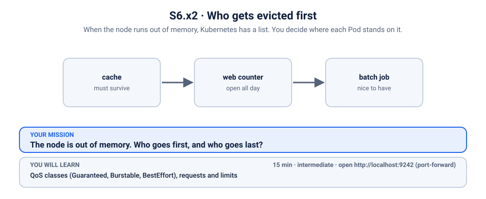
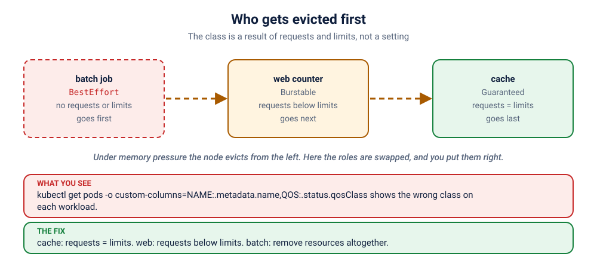

# S6.x2 · Who gets evicted first

*When the node runs out of memory, Kubernetes has a list. You decide where each Pod stands on it.*

⏱ 15 min · intermediate · Three little stalls (`http-echo`, 17 MB) · QoS classes (`Guaranteed`, `Burstable`, `BestEffort`), requests and limits

⬇️ Nothing big: one image, three Deployments. A slow first pull is normal.

Output columns and wording can differ a little between kubectl versions and clusters (kind, minikube, Docker Desktop, playgrounds). The ideas never change.

> 🧭 **Practice lane: "Resources"**, the boss of the lane, after [S5.5](../../../5-scaling-self-healing-and-releases/5-ai-trainer-oomkilled/README.md) and [S6.5](../../5-surprise-limitrange-oom/README.md). No hints for the first 5 minutes. Previous: [S5.x5](../../../5-scaling-self-healing-and-releases/exercises/5-autoscaler-pointing-at-nobody/README.md).

## 📖 The story
A food court shares one kitchen fridge. On a crowded night the fridge fills up, and the manager must **throw something out**. There is a list, and it is not random: stalls that promised to stay small and kept the promise go last; stalls that never said how much room they needed go first.

Three stalls share the fridge: a **cache** the whole court depends on, a **web counter** that should stay open all day, and a **batch** job that is nice to have. Right now, the cache is at risk, the web counter is protected too much, and the batch job is not at the front of the queue. Your job: put each in the right place on the list.

## 🏆 Rules of this one
- **No visitor this time.** Nothing is broken that you can see; the problem is where each stall stands.
- **Check your work with `./check.sh`**, any time. It only looks.
- **Scoring (for fun):** gold = under 8 minutes, no hints; silver = under 15; bronze = hints used. Everyone still eats.



## 🧠 The concept



Every Pod gets a **QoS class**, computed from its requests and limits. It decides who is evicted first when a node is short of memory:

| Class | When you get it | Evicted |
|---|---|---|
| `BestEffort` | no requests or limits at all | **first** |
| `Burstable` | some requests or limits, not all equal | in the middle |
| `Guaranteed` | every container: requests = limits (cpu *and* memory) | **last** |

It is a result, not a setting: you cannot write `qosClass`. You change requests and limits and Kubernetes works it out.

## 🔮 Predict first
Look at the table above. A Pod that sets `requests` but no `limits`: which class? And a Pod that sets nothing? Write both down.

<details><summary>Check your prediction</summary>

Requests only: **Burstable**. Nothing at all: **BestEffort**. Only equal requests and limits on every resource of every container make **Guaranteed**.
</details>

## 💥 Break it
```bash
cd break && python3 run.py
```
```bash
kubectl get pods -n k-42-qos -o custom-columns=NAME:.metadata.name,QOS:.status.qosClass
```

## 🔍 Investigate: you drive
**What is the first thing you look at?**
<details><summary>💡 Tier 1: a nudge</summary>
Ask each Pod for its class. Then ask yourself which class each of the three *should* be: the cache the court depends on, the all-day web counter, and the nice-to-have batch job.
</details>
<details><summary>💡 Tier 2: the commands</summary>

```bash
kubectl get pods -n k-42-qos -o custom-columns=NAME:.metadata.name,QOS:.status.qosClass
kubectl get deployment cache web batch -n k-42-qos -o jsonpath='{range .items[*]}{.metadata.name}{" "}{.spec.template.spec.containers[0].resources}{"\n"}{end}'
```
</details>
<details><summary>💡 Tier 3: the answers to look for</summary>

Wanted: `cache` = Guaranteed (requests equal limits), `web` = Burstable (some headroom to grow), `batch` = BestEffort (no requests or limits, first to go). Right now the roles are swapped: the cache is Burstable, `web` is Guaranteed, and the batch job is Burstable.
</details>

## 🪤 The tempting wrong fix
Give *everything* equal requests and limits so everything is `Guaranteed`. Now nothing is safe to evict, and the scheduler needs far more room to place any of it. **Guaranteed everywhere means priority nowhere.** Pick who is precious.

## 🩺 Root cause
<details><summary>Reveal after the room guesses</summary>

Only requests and limits decide the class, and `kubectl` shows the result. The cache has requests but no limits (Burstable). `web` has requests = limits (Guaranteed). The batch job has requests (Burstable). To flip the order, change what each one says about itself.
</details>

## 🔧 Fix it
```bash
cd ../fix && python3 run.py
```
The reference fix sets cache requests = limits, `web` requests below limits, and removes the resources block from `batch`. Each Deployment rolls to a new Pod with the new class.

## ✅ Verify it yourself
```bash
cd .. && ./check.sh
```
It prints the class of each workload's newest Pod and whether it is the right one.

## 🎯 Key takeaways
- **QoS is a result.** You change requests and limits; Kubernetes computes the class.
- **Guaranteed = requests equal limits, for every container, for cpu and memory.**
- **BestEffort goes first under pressure.** Fine for batch, bad for anything people use.
- **Not everything can be Guaranteed.** Priorities mean something only if they differ.

## 💎 Lifelong lesson
> If everything is a priority, nothing is.

## 🏢 Where you'll meet this at work
- **A database with no requests** gets evicted before a log shipper (everyone).
- **Capacity reviews** ask why the cluster is "full" when usage is low: requests (platform team).

## 🧹 Clean up
```bash
./cleanup.sh
```

## Next →
That finishes the Resources lane. Back to the [scenario list](../../../README.md), or on to the security lane: [S4.x2](../../../4-config-storage-and-security/exercises/2-maintenance-van-wants-the-master-key/README.md).
